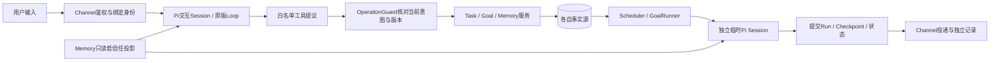

# Personal Agent评测前审计

审计日期：2026-11-07（Asia/Shanghai）。对象是本工作目录的实际源码，基线`e2c95c067d4f33aa5cd9fdb0c6b17e40bc82ba4b`，原分支`codex/workthread-foundation`；评测使用新分支`codex/agent-eval-baseline`。本轮没有修改`src/`、SDK、业务Schema或正式配置。

## 先明确版本

开始时有一份已修改的`docs/STATE.md`和10份未跟踪的规划/审查文档；均已记录原Hash。STATE讲述另一个工作树的进展，不能据此判断本目录具备哪些功能。

本地引用与工作树清单显示：`codex/router-worker-mvp`在`91b7a65`，`codex/work-core-stages`在`d0cfcbc`；topic-session相关工作树也存在。本轮没有切换、合并、迁移或执行这些工作树的代码，也没有核验其远端现状。因此本报告不评价这些分支的最新能力；需要评测它们时应另冻结基线。

读取范围包括AGENTS、PROJECT、STATE、README、Goal/主动策略/Skills/Web/WorkThread设计、相关源码与测试，以及Manual Goal v1/v2、M3修复、Formation、Memory和路由审查记录。只读取仓库中的脱敏历史材料，没有打开历史业务库、正式`.env`、用户Session或Memory。

## 当前能力矩阵

“通过”指本次离线工程证据，不能代指真实模型语义或生产稳定性。详细命令与结果见[结果](EVAL_RESULTS.md)。

| 模块 | 当前分支实际实现 | 本次证据与结论 | 尚缺的证明 |
| --- | --- | --- | --- |
| Pi Agent Loop | 原版1.3.0；公开Session/工具/扩展API | A01/A02、F01实际经过Pi与本机SSE；模型/工具错误不能直接算成功 | 工具选择和自然语言决策均由桩指定，无新真实模型分数 |
| Runtime边界 | `AgentExecutor`隔离业务层；`agent_settled`后继续检查异常 | 已实现并通过多数生命周期回归；F01暴露Goal错误分类缺陷 | Goal的HTTP错误分类仍需修复 |
| Task | UTC一次性任务、SQLite事务领取、唯一Run、pending取消 | B01～B06通过；实际子进程退出/强杀与新PID恢复 | 无长期准点率、跨机器或外部副作用恰好一次证明 |
| Console/飞书 | 确定性命令或受控模型工具；飞书白名单及持久去重 | B05实际FeishuChannel＋Mock Transport；全量已有渠道测试通过 | 不发送真实飞书；不刷新旧手机验收结论 |
| Web | 本机HTTP认证、CSRF、Run关联、展示ACK、持久收件箱 | 已实现；本次全量Web/API/进程回归通过 | 无本轮浏览器交互、手机、LAN、HTTPS或Push验收 |
| Session | Console/飞书/Web按宿主chatKey区分；原生JSONL恢复；后台临时会话 | D01恢复与空Session对照通过；现有真实main子进程测试亦通过 | 不是自动主题Session；JSONL/SQLite不构成跨存储事务 |
| Memory | 四类Markdown事实源、可重建SQLite索引、明确意图写入、临时context投影 | E01更新/新Session/On-Off通过；E02恶意资料不能授权写入 | 单用户共享Memory，无多租户Scope隔离承诺；词法能力有限 |
| Manual Goal | Plan/稳定Step/Execution/Checkpoint；一次明确授权一段；用户确认完成 | C01生命周期与3次Execution；C02暂停/取消迟到结果；C03坏JSON恢复通过 | 模型计划质量、任意话术理解、真实完成率未新测 |
| Goal状态表述 | 同源宿主ToolResult、用户输出、Session控制收据 | C04宿主明确审批未排队；原始历史模型错误仍保留为失败 | 没有证明新模型普遍理解宿主状态 |
| 主动策略/观察 | 默认关闭；显式Console策略、时间/GitHub观察、Grant、预算、有限Outbox | 当前源码已实现，既有policy/observer/autonomy测试本次重跑 | 未新建专项数据集或真实外部观察；非任意事件总线 |
| WorkThread | 默认关闭；Web手动组织Goal/Task/Run/Memory元数据 | D02幂等关联、权限、磁盘关系、归档不取消Task通过 | 不负责执行、不带主题上下文，也不增加Memory读取权 |
| 总管/Worker/自动主题路由 | 本基线没有对应生产模块 | D03明确skipped | 其他工作树存在实现/计划，不挪用其成绩 |
| 文件/敏感工具 | 默认关闭；批准资料副本read/ls/find/grep；write/edit冻结提议后确认 | F02公开工具适配器验证批准/越界/Hash；原审批回归通过 | 新评测未覆盖完整Web文件确认体验；不是OS级沙箱 |
| Trace/错误 | runs/run_events/model_calls；Goal执行和投递独立 | 本轮保留每Case实际状态、工具参数/结果、HTTP桩交互、PID与退出信号 | 兼容Provider费用可能null；强杀可能缺usage；日志不等于账单 |
| 任意Shell/MCP、多Agent并行、完整PWA推送 | 本基线未实现/未开放 | 不计分，不新增功能 | 不能写进本版本的已实现能力 |

## 关键执行链

1. **交互**：Console、飞书或Web先确定可信目标和Run。Pi Loop决定工具和参数；写操作再由Guard对当前原话做隔离意图解析、检查候选/版本/展示与投递凭据，并授予单次服务调用权限。模型提议或历史消息不等于授权。Guard的有界规则和模型解析本身也有语义局限。
2. **Task**：`TaskService.create → parseTaskTime → SqliteStore.createTask`保存pending；Scheduler就绪检查后，事务内`claimDue`同时变running和插入Run。后台独立无工具Session执行；提交终态，再发送。失败/中断/通知失败均不重跑模型；启动持锁后`recoverInterrupted`保留pending，把遗留running改interrupted。
3. **Manual Goal**：明确创建授权bootstrap；模型提出草稿，Checkpoint提交为waiting_user。用户批准只替换正式Plan，不自动排队；明确继续才写readyInput。Runner消费一次授权、冻结输入、执行一个无工具片段；Schema及聚合事务校验后提交Checkpoint。Step complete仍不等于Goal completed，最后需要用户确认。暂停/取消先持久化撤销提交权限，迟到结果不能推进。
4. **主动Goal**：显式策略绑定身份、Goal/Plan版本和限额；时间/公开GitHub观察产生Trigger/Grant。领取时核对并消费Grant和预算；每次一段，满足严格条件才授权下段。策略通知有有限Outbox；旧Task/聊天/Manual Goal没有同样保障。
5. **Memory/Session/主题**：Session保存短期对话；Memory经服务保存当前长期事实并在context事件临时注入；Task/Goal保存执行事实。WorkThread只保存对象ID关系。当前单个Web聊天不根据主题自动拆Session。

实现定位：[Pi适配](../src/pi-executor.ts)、[Guard](../src/operation-guard.ts)、[Task Store](../src/sqlite-store.ts)、[Scheduler](../src/scheduler.ts)、[Goal Store](../src/goal-store.ts)、[Goal Runner](../src/goal-runner.ts)、[Memory](../src/memory-service.ts)、[主题服务](../src/work-thread-service.ts)、[宿主入口](../src/main.ts)。

## Manual Goal历史复核

| 历史案例 | 可核对事实 | 当前处理与证据界限 |
| --- | --- | --- |
| v1 M3虚假排队 | 宿主waiting_user、Plan v1已批、readyInput=null，没有正式Execution；模型却说“正式步骤还在排队等待执行” | 当前渲染器已有“尚未排队或执行，需再次继续”。C04强制回放原脱敏回复：宿主正确，原始语义仍错误；这不证明当前模型重现该错误 |
| v2 M3 | 旧报告记录新增明确状态说明后的一次真实正确回答 | 属于历史样本，不计本轮成绩，也不证明普遍修复 |
| v2 M5 | 模型将“不得编造”扩大解释为“不能复述已提交题目”；宿主实际交付正确 | 只有历史脱敏报告/JSON，未取得本轮完整原始响应，不虚构回放 |
| v2 M8 | Step complete，Goal waiting_user；“到此就结束了”有结束歧义，宿主仍要求用户确认 | 标为needs_review，不能硬判明确虚假完成；无新真实模型FCR |

原件：[v1报告](evaluations/manual-goal-console-live-acceptance.md)、[v2报告](evaluations/manual-goal-console-v2-live-acceptance.md)、[M3根因与最小修复](evaluations/m3-state-offline-fix.md)、[固定脱敏Fixture](../tests/fixtures/manual-m3-approved-not-queued.json)。本轮没有改写历史评分。

## 最严重的可靠性风险

1. **执行完成与通知送达没有共同持久保障。** B07渠道故障恢复后仍无补发；真实SIGKILL发生在Task结果提交后、投递前，新PID不重跑Task，也没有通知恢复。用户可能永远不知道任务完成。最小后续方案是复用现有Outbox思想，将旧Task结果与待投递记录同事务提交，投递只重试消息，保留“确认丢失可能重复”的边界。属于生产语义扩展，本轮只建议。
2. **模型原始解释与宿主事实可分离。** C04证明错误模型文本仍可能写入Session，随后宿主收据纠正用户可见结果；不能据此宣称模型本身可靠。后续应在独立零副作用环境对明确状态声明作宿主核对，并做经授权的真实重复测试；不让模型自判完成。
3. **当前Goal错误分类失真。** F01的429/500在Task为failed，Goal却为interrupted。`runPiSession`在Goal非stop时先abort；后续先判断stopped，遮蔽modelError。最小修复候选：分别记录宿主因契约约束停止、真实外部取消与超时，在不允许第二请求的前提下保留原始模型失败原因；用同一F01复测。不能只放宽断言接受任意终态。
4. **保守恢复牺牲自动继续。** 运行中Task恢复为interrupted、Goal为blocked；不会丢弃记录，但也不会自动完成未竟工作。这是当前安全策略，不是“自动恢复执行成功”。
5. **覆盖和部署边界。** 串行后台的慢任务会推迟后续提醒；Session/Task/Memory跨存储窗口、入站去重后执行前崩溃、长对话无压缩、长跑/真实供应商/多Scope均缺充分验证。测试通过不应掩盖这些限制。

本轮未做生产Bug修复，没有把评测建设扩展为功能重构。可展示的稳定部分及简历措辞见[面试材料](EVAL_INTERVIEW.md)。
