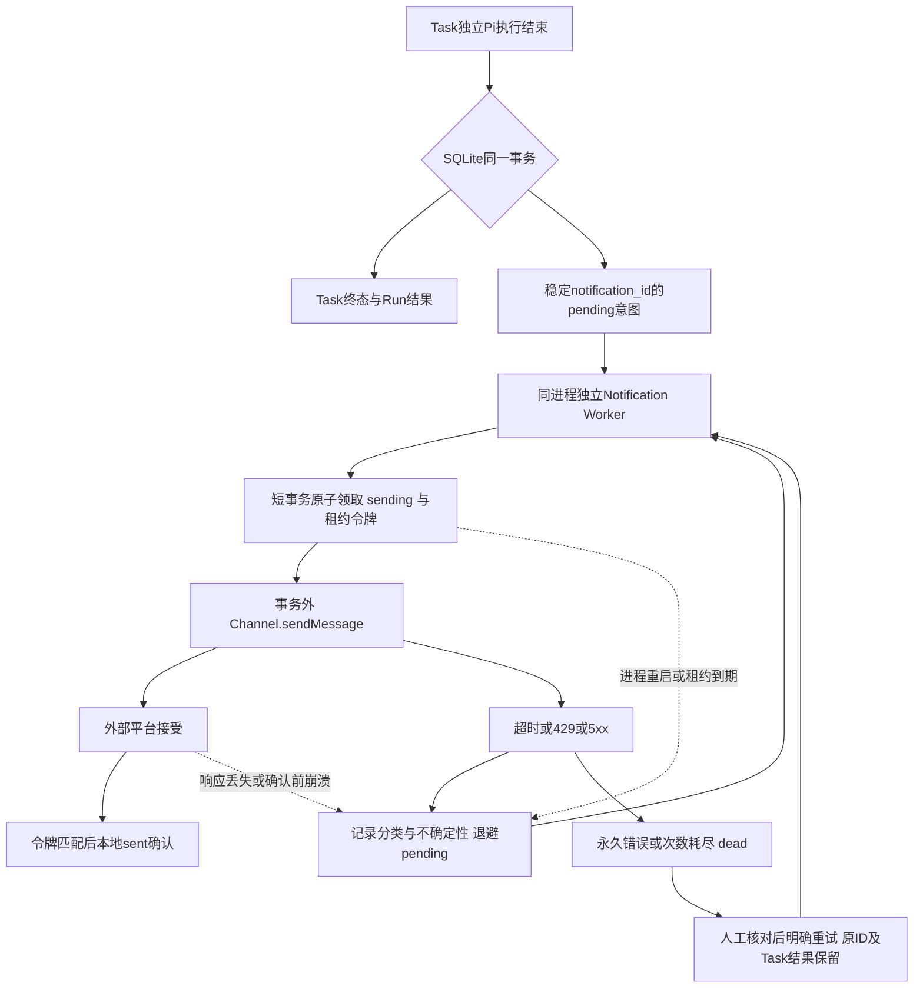

# 第二轮：Notification Reliability & Goal Error Recovery Optimization

2026-11-07，独立分支`codex/notification-goal-recovery`。先审计并复现，再在现有通知表上增量修复。生产源码固定基线为`e2c95c0`，第一轮评测提交`0d034eb`；冻结归档与相同依赖隔离运行。未合并main，未操作正式SQLite/Session/Memory、真实飞书或收费模型，未修改Pi SDK，无新依赖。

新增30题：旧代码6通过/24失败，优化后30通过/0失败/0错误/0跳过。原20题、断言和历史证据保留：16/3/1变为17/2/1。每题仅一次固定脚本运行，不代表模型准确率、线上可靠性或长期统计结果。

## 第一轮三个失败的根因

| 原Case | 根因 | 本轮结果 |
| --- | --- | --- |
| B07 | Task/Run先提交，Scheduler直接发送，未与结果同事务保存发送意图；发送失败或提交后崩溃没有可恢复记录 | 已修复持久意图及崩溃窗口；原题仍failed：它在相同时间立即再次tick就要求送达，新机制遵守30秒退避。原断言不改，新增N03–N08验证实际恢复 |
| F01 | Goal遇到非stop响应会由宿主abort；随后把这次主动停止统一当interrupted，HTTP429/500信息丢失 | 保留原工具越界停止语义，仅让宿主已捕获的HTTP分类穿过该层。原F01的12项检查通过 |
| C04 | 历史Manual Goal M3原始自然语言声称“已排队”，数据库却为waiting_user且readyInput=null；历史输出语义与宿主事实冲突 | 继续失败；没有改写历史回复、数据库或预期。不是本轮通知/HTTP缺陷，也没有新收费模型语义复验 |

原D03仍跳过：本工作树没有自动主题路由。其他分支的实现不能计入。

## 为什么复用Outbox

原`GoalNotificationStore/goal_notifications`已用于策略Goal，具备结果同事务入箱和有限重试雏形；Task没有接入。沿用类名、表名、已有策略文本与权限，不另建消息框架。旧表的runId外键仅允许Goal Execution，本轮在事务内完整复制迁移为引用通用Run、Goal可空，新增taskId和投递元数据。N15以旧DDL/记录验证ID、状态、次数、Checkpoint及外键兼容；没有在正式库执行迁移。

Outbox适合单机SQLite：结果与意图同一事务消除“双写”窗口，网络放在事务外。它不能把SQLite提交与外部平台接受变成同一事务，仍可能重复。[Microsoft的事务Outbox说明](https://learn.microsoft.com/en-us/power-platform/architecture/reference-architectures/transactional-outbox-pattern)也明确区分原子保存与重复处理。

四个阶段独立：Task成功、意图持久化、平台接受、本地确认。Worker不领取Task、不调用模型、不持有模型执行门。生产组装注入独立Worker；旧Scheduler直接构造方式保留一次即时投递以兼容现有调用。策略Goal仍受原主动总开关约束；默认Worker仅处理Task。

## 故障窗口与边界

| 窗口 | 本轮处理 | 用例 |
| --- | --- | --- |
| 完成后意图持久化前崩溃 | 完成与入箱同事务；事务内SIGKILL整体回滚，恢复为interrupted，不补跑模型 | N02、N17 |
| 入箱后发送前崩溃 | pending可重启领取；sending恢复为pending或dead并标uncertain | N03 |
| 网络超时/永不返回 | 默认10秒发送上限；记录timeout/uncertain，30秒起退避；外部请求未必已终止 | N04、N18 |
| 外部接受但响应丢失 | 保留同一ID并有界重投，可能重复；uncertain不伪装已确认 | N07 |
| 外部成功、本地sent前SIGKILL | 新进程读取旧意图恢复，可能再次被平台接受 | N08 |
| 两Worker领取同条 | BEGIN IMMEDIATE内条件更新、租约令牌；仅当前令牌可确认，过期旧回调失效 | N09、N16 |
| 任务取消后的迟到回调 | V0仍只允许pending取消，取消后不能领取/提交旧执行；待发记录遇到cancelled任务停止 | N11 |

N11验证合法pending取消及迟到仓储调用被拒绝；不新增“取消已完成/运行Task”。已经在外部发送中的消息无法撤回，本轮未声称解决这一平台问题。N09覆盖两个独立SQLite连接；没有扩展多主机部署或取消原进程独占锁。

通知状态`pending/sending/sent/dead/cancelled`与Task状态独立。默认发送超时10秒、租约至少30秒；按较长超时扩展租约。每轮至多3次，30/60秒指数退避，429按更长Retry-After等待，5xx有限重试，永久业务错误直接dead。原子确认和失败回写都比较leaseToken，过期回调不能覆盖新状态。进程启动持有原独占锁后恢复旧sending；运行中租约过期也可回收，均留下不确定性。

Console的`/notifications`查看本渠道记录，`/notification retry <ID>`明确为dead新增一轮投递机会，保留ID、总尝试次数和人工重试事件，不重跑Task。没有新增飞书/Web人工入口。不补发迁移前已完成Task的历史未知通知。

稳定notificationId经统一Channel接口传递，飞书分片uuid由其派生；未验证供应商去重期限或幂等承诺。响应丢失和SIGKILL对照中出现重复是设计公开的结果。`uncertain=1`保留历史上可能已送达的事实，即便后来sent也不抹除。有限重投和死信只保证意图持久及有界的至少一次尝试，不保证永久必达或Exactly-once。

## Goal分类与恢复

HTTP状态和Retry-After只在适配入口解析一次，使用安全结构化`ExecutionFailure`，不保存响应正文或请求头。Pi公开兼容Provider流回调仍调用原版SDK原生streamSimple，仅自定义fetch观察HTTP结果；SDK内部重试保持0，不改Agent Loop。宿主使用AsyncLocalStorage隔离每次错误元数据。公开after_provider_response在本SDK错误响应路径不触发，初版故障已留存；最终采用上述入口观测并实测。

| 分类 | 原状态兼容方式 | 自动重试 |
| --- | --- | --- |
| Rate Limited | Run/Execution failed，Goal blocked，reasonCode=rate_limited；事件保存429、Retry-After、retryAt | 仅显式开启的手动无工具text_only |
| Transient Server Error | failed/blocked，reasonCode=transient_server_error；保留HTTP5xx | 同上，次数有上限 |
| Permanent Error | failed/blocked，reasonCode=permanent_error | 不重试 |
| User Cancelled | 用户控制仍落cancelled/paused，执行interrupted，记录user_cancelled | 不重试 |
| Process Interrupted | 真SIGKILL后恢复interrupted/blocked，reasonCode=process_interrupted，旧Checkpoint保留 | 不重放执行 |
| Waiting for Approval | waiting_user与pendingAction，继续使用原审批收据 | 不视为错误，不产生执行授权 |
| Timeout/Unknown | 保留中断或原失败终态，单独timeout元数据；未知结果不猜成功 | 不自动重试 |

`GOAL_MAX_ATTEMPTS=1`为默认；显式2/3含首次。429/5xx采用1/2秒退避与更长Retry-After（支持秒数/HTTP日期）；超过60秒则停止在blocked，记录最早可尝试时间，不截短等待。Retry-After语义依据[RFC 9110](https://www.rfc-editor.org/info/rfc9110/)，429见[RFC 6585](https://www.rfc-editor.org/info/rfc6585/)。每次重试新建临时Session，同一授权/Run/Execution，重试后仍由原事务校验revision、计划、控制与Checkpoint。

策略Goal仍一次HTTP，避免超出原策略次数/费用预留。当前仅允许无工具纯文本片段重试；没有新增非幂等外部写工具，也没有可核验状态的外部操作恢复器。若将来开放外部写，必须先查平台真实执行状态，未知则人工确认，不能重放。取消/拒绝审批/超时/未知传输错误/工具提议/无效JSON不会因配置次数而自动重试；模型声称成功也不能跳过原宿主校验。

## 同集对照与指标定义

对照在同一套runner及dataset Hash下执行固定旧源码和当前源码，每题一次。旧代码缺少新能力时明确failed；不使用替身Outbox冒充旧实现。两边使用独立临时SQLite、Mock Channel、本机HTTP/SSE与真实Pi；SIGSTOP标记故障窗口、父进程SIGKILL并等实际退出，再启动新PID恢复。子进程环境不继承真实凭据。

共同通知分母固定11题：N01/N03/N04/N05/N06/N07/N08/N10/N12/N13/N14；可恢复子集固定N03–N08共6题。事务未提交、取消、迁移、并发/租约专项及新超时能力不混入该11题。N16/N18能力通过仍单独保留，未删减用例；每题截止时间见Trace。

| 指标及分母 | 优化前 | 优化后 |
| --- | --- | --- |
| Intent Persistence：持久意图/11个应通知Task | 0/11 | 11/11 |
| Delivery Success：至少一次外部接受/同11题 | 4/11 | 9/11 |
| Local Sent Confirmation：本地成功确认/同11题 | 2/11 | 9/11 |
| Loss：截止窗口无外部接受/同11题 | 7/11（63.6%） | 2/11（18.2%） |
| Recoverable Loss：截止无外部接受/固定6种可恢复故障 | 4/6 | 0/6 |
| Recovery：外部接受且本地确认/固定6种可恢复故障 | 0/6 | 6/6 |
| Duplicate：多次外部接受的题/至少一次接受的题 | 0/4 | 2/9（22.2%） |
| Task一致性：succeeded且仅1次模型执行/同11题 | 11/11 | 11/11 |
| Retry Classification：每题首次故障分类正确/11题有分类观察 | 0/11 | 11/11 |
| Goal State Accuracy：宿主状态符合断言/12个Goal场景 | 10/12 | 12/12 |

分类分母11题为N04/N05/N06/N07/G01/G02/G03/G04/G05/G06/G12；每题只计首次错误，避免三次500过度加权。429子集N05/G01/G02/G12：0/4→4/4；500子集N06/G03/G05/G06：0/4→4/4。Goal单独的429/500子集：0/6→6/6。无结构化错误算分类错误，不能靠读错误文案猜命中。

剩余2/11未接受是N12持续错误耗尽和N13永久业务拒绝；这两题通过表示正确进入dead，并非消息送达。旧代码N07/N08已被外部接受，但本地未确认，不能算恢复成功，也不能算“未被平台接受”的丢失。重复率按题计算，非消息条数；增加重投扩大了接受人群，两边分母不同，不应单独据此评价线上去重质量。

| 通知延迟：Task执行结果生成至首次外部接受 | 优化前 | 优化后 |
| --- | --- | --- |
| 受控逻辑时钟 P50/P95 | 0/0 ms，n=4 | 0/300000 ms，n=9 |
| 实际墙钟 P50/P95 | 0/0 ms，n=4 | 1/221 ms，n=9 |

使用nearest-rank分位；受控时钟推进退避/人工等待，P95含N14人工5分钟后重试；墙钟未真实等待30/60秒。仅接受过的题有延迟，旧失败样本没有被填成0，两组生存样本不同。样本不足，不能推断生产P95、吞吐、网络性能或延迟优化。

## 逐题、Trace与机器产物

| ID | 场景 | 固定旧代码 | 优化后 |
| --- | --- | --- | --- |
| N01 | 正常完成、持久意图、外部接受、本地确认 | failed | passed |
| N02 | 意图事务内强杀整体回滚 | passed | passed |
| N03 | 提交后发送前SIGKILL与重启 | failed | passed |
| N04 | 发送前超时后恢复 | failed | passed |
| N05 | 429遵守Retry-After后恢复 | failed | passed |
| N06 | 500退避后恢复 | failed | passed |
| N07 | 外部接受但响应丢失 | failed | passed |
| N08 | 外部接受后Sent前SIGKILL | failed | passed |
| N09 | 两个Worker不同SQLite连接并发领取 | failed | passed |
| N10 | 重复完成/重复触发通知 | failed | passed |
| N11 | 取消pending后迟到回调 | passed | passed |
| N12 | 达到三次上限进入dead | failed | passed |
| N13 | 永久业务错误直接dead | failed | passed |
| N14 | dead人工重试不重跑Task | failed | passed |
| N15 | 旧Goal Outbox无损升级 | passed | passed |
| N16 | 过期租约fencing与重复风险 | failed | passed |
| N17 | Task发送意图插入失败整体回滚 | failed | passed |
| N18 | 挂起渠道的真正超时与恢复 | failed | passed |
| G01 | 429分类与Retry-After元数据 | failed | passed |
| G02 | 429受控重试成功 | failed | passed |
| G03 | 500受控退避成功 | failed | passed |
| G04 | 永久400不重试 | failed | passed |
| G05 | 500三次耗尽明确失败 | failed | passed |
| G06 | 用户取消中止等待重试 | failed | passed |
| G07 | 等待审批不是执行授权 | passed | passed |
| G08 | 用户拒绝计划后不执行 | passed | passed |
| G09 | 非幂等工具提议不得执行或重试 | passed | passed |
| G10 | 真实超时不当500重试 | failed | passed |
| G11 | Goal真实进程中断恢复 | failed | passed |
| G12 | 长Retry-After不能截短提前重试 | failed | passed |

原始完整记录仅留本地，Git忽略；首轮150份证据及原20题源码Hash按初始快照核对。原第一轮文档正文保留在更新文档的历史章节，固定提交仍可复核。

- [对照JSON](../evals/reports/phase2-comparison/comparison.json)：两边元数据/源码Hash、runner Hash、完整指标、逐题检查及Trace Hash。
- [对照表](../evals/reports/phase2-comparison/comparison.md)、[旧代码逐题JSON](../evals/reports/phase2-before-final/results.json)、[当前逐题JSON](../evals/reports/phase2-after-final/results.json)。`results.json`保存逐题JSON；每题另有`ID.trace.json`，同时包含该题结果与完整Trace。
- 关键失败/恢复轨迹：[旧N03](../evals/reports/phase2-before-final/N03.trace.json)、[新N03](../evals/reports/phase2-after-final/N03.trace.json)、[响应丢失N07](../evals/reports/phase2-after-final/N07.trace.json)、[确认前强杀N08](../evals/reports/phase2-after-final/N08.trace.json)、[429 G02](../evals/reports/phase2-after-final/G02.trace.json)、[500耗尽G05](../evals/reports/phase2-after-final/G05.trace.json)。
- [原20题最终复跑](../evals/reports/phase2-after-original20-verified/results.json)和[复跑前](../evals/reports/phase2-before-original20/results.json)；第一次误在禁止监听的沙箱复跑产生error的目录另存，不计业务对照。
- [验证与保护清单](../evals/reports/phase2-verification/verification.json)：实际命令结果、初次失败日志、环境限制及旧证据保护结果。

## 修改文件与目的

| 文件 | 目的 |
| --- | --- |
| `src/goal-notification-store.ts` | 复用/迁移现有通知表、Task入箱、原子租约与CAS、错误/不确定性、有限重投及人工重试 |
| `src/sqlite-store.ts` | Task终态和通知意图同事务，既有普通finishRun兼容 |
| `src/notification-worker.ts`（新增） | 不占模型门的同进程投递循环，默认Task-only |
| `src/scheduler.ts`、`src/main.ts` | 任务执行与投递生命周期分开，注入独立Worker并按渠道过滤 |
| `src/contracts.ts` | 可选notificationId及可区分超时类型 |
| `src/execution-failure.ts`（新增）、`src/feishu-transport.ts` | 安全HTTP分类与Retry-After入口解析，保留旧人类可读错误 |
| `src/feishu-channel.ts` | 从稳定通知ID派生分片uuid |
| `src/console-channel.ts` | 查看当前渠道通知及明确dead重试 |
| `src/pi-executor.ts` | 公开兼容Provider传输采集HTTP错误，修复自发abort掩盖分类，保留原越界工具停止 |
| `src/goal-runner.ts`、`src/goal-store.ts`、`src/config.ts` | 可选有界纯文本重试及原因元数据，原状态/授权/Checkpoint兼容 |
| `evals/datasets/phase2-v1.json`（新增） | 固定新增30题规格；原20题数据集不动 |
| `evals/environments/notifications.ts`、`goal-recovery.ts`（新增） | 同一测试器动态加载真实固定源码，临时SQLite/渠道/本机SSE |
| `evals/runners/phase2.ts`、`phase2-notifications.ts`、`phase2-goals.ts`（新增） | 逐题执行、故障注入、完整Trace及Hash，不覆盖旧运行 |
| `evals/evaluators/phase2.ts`（新增） | 四阶段指标、固定分母及条件延迟 |
| `tests/helpers/notification-process.ts`（新增） | 真实故障窗口/进程强杀与重启的最小子进程 |
| `tests/notification-reliability.test.ts`、`notification-adapters.test.ts`（新增） | 30场景回归及3项HTTP/配置/开关适配验证 |
| `tests/independent-console-flow.test.ts` | 异常退出报告信号；原退出码断言不改，用于定位既有全量回归异常 |
| `package.json` | 新增eval:phase2，无依赖变更 |
| `.env.example`、`README.md`、`docs/PROJECT.md` | 默认次数、通知操作和已确认架构同步；不改实际.env |
| 本报告、`EVAL_RESULTS.md`、`EVAL_INTERVIEW.md`、`STATE.md` | 更新数据、局限及交接；原本地跨工作树记录保留 |

## 验证与剩余风险

- `TMPDIR=/private/tmp npm test`：退出0，624/624通过，0失败/取消/跳过；原591项+新增30故障场景+3适配验证。`npm run typecheck`、`npm run build`、`npm run web:build`均退出0；Web构建保留原依赖的use client指令警告。
- 原20题最终`eval:agent`退出1，17通过/2失败/1跳过；失败保留，非“全部通过”。新增同集旧代码6/24、当前30/30。41项相关回归单独通过。
- 初次全量621项中619通过：一处Goal非法工具停止被过宽分类成failed，已恢复原interrupted兼容并验证旧8项Goal Skill；另一处Console HTTP失败路径子进程code=null。第二次624项为623通过，同一Console路径再次异常。单独1/1及最终完整624/624未再现；退出信号当时未记录，现仅补充诊断信号，不改断言，不声称已查清或修复偶发根因。
- 一次复跑误在受限沙箱启动，127.0.0.1监听EPERM，另存失败记录；获得回环权限后，默认`/var`临时路径触发既有Skill防符号链接检查。使用真实路径`TMPDIR=/private/tmp`保持校验后完整运行。未改该安全校验或把环境失败计入业务对照。
- 首轮150份原始证据、10份无关未跟踪文档、原20题4份实现/数据集及EVAL_AUDIT/EVAL_PLAN Hash全保持；原STATE跨工作树交接段完整保留。当前源码、runner与最终第二轮元数据Hash一致，Trace Hash逐份核对。无新提交；HEAD仍0d034eb。

当前没有真实飞书/收费模型/生产库迁移/跨OS/长时间恢复或吞吐验证；兼容Provider以外的HTTP元数据路径未验证。服务启动仍依赖原Memory等健康检查，启动失败时Worker也不能运行。可选Goal重试等待仍占原后台执行门，慢片段可能延迟Task；没有借本轮重构调度公平性。Chat及手动Goal通知仍直接发送。长期语义质量、原M3失败、自动路由D03继续开放。

不能将本轮表述成“通知零丢失、零重复、Exactly-once、生产100%成功”或“真实模型能力提升”。

## 可用于简历的表述

- 在TypeScript/SQLite Personal Agent中复用Transactional Outbox，使Task结果与通知意图原子提交，增加租约领取、令牌确认、有限退避及死信人工重试；消息失败不重跑已完成任务。
- 建立30项隔离故障评测，覆盖真实子进程SIGKILL、外部接受但确认丢失、双连接竞争及租约过期；固定6种可恢复故障由0/6恢复到6/6，明确记录重复投递边界。
- 修复Pi宿主自发abort掩盖HTTP错误，区分429/5xx/永久失败/用户控制/进程中断；同集8个429/500分类场景由0/8到8/8，纯文本重试保持授权与Checkpoint校验。

这些是单机离线机制数据；简历若写624项回归，必须以最终验证记录为准，不能替换成线上指标。

## 面试追问与回答要点

1. 为什么需要Outbox？结果提交和网络发送无法同一事务；先把结果与意图原子提交，网络由Worker另行处理。
2. 为什么复用旧表？已有策略Goal Outbox，缺口是Task接入与领取/恢复；重复建设会增加事实源和迁移成本。
3. 为什么不是Exactly-once？平台接受与本地sent确认之间仍有窗口；不支持可靠外部幂等时，重试可能重复。
4. 稳定ID能解决什么？关联多次尝试及平台幂等键；不能自行证明平台实际去重期限和分片效果。
5. 为什么要租约和令牌？租约允许死亡发送者被接替；令牌防止旧发送者回来覆盖新确认，不阻止已经在途的外部副作用。
6. 两Worker怎么避免双领？同库短事务和条件更新；验证两个连接，不声称支持多机。
7. 事务提交前后强杀分别怎样？前者整体回滚并保守中断，后者保留pending供恢复；都不盲目重放模型。
8. 超时是否等于没有发送？不等于；未知结果记uncertain，重投可能重复，死信需人工核对。
9. 429/500如何重试？明确分类、遵守Retry-After、退避且有上限；长等待阻塞，不靠缩短等待假装恢复。
10. 非幂等工具可以同样重试吗？当前不开放；必须核验真实状态，未知不自动重放。用户取消和拒绝绝不重试。
11. 为什么默认Goal仍一次？保持费用与调用行为兼容；策略执行已有单请求预算，不能悄悄扩大。
12. 如何证明测试没有把失败藏起来？固定旧题不改，旧失败Trace/Hash保留，新增共同分母明确，死信、重复和条件延迟全部单列。
