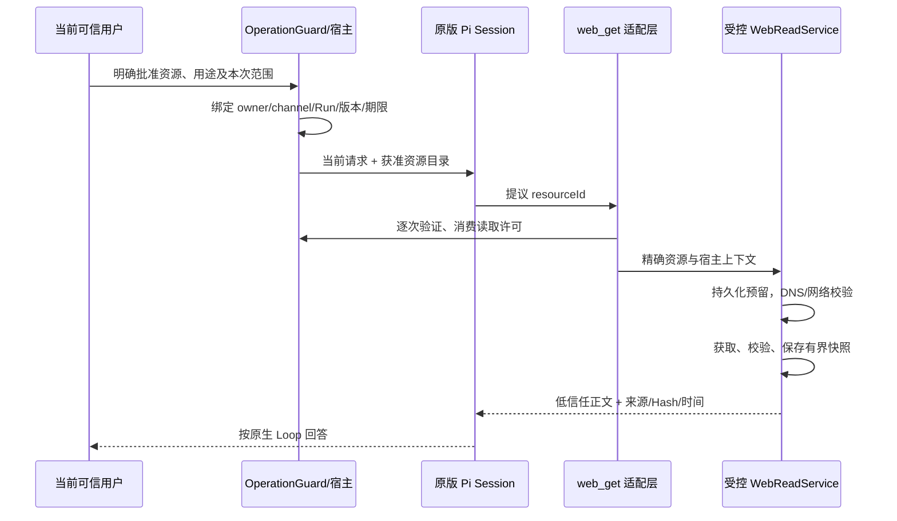

# S1 受控只读 Tools：最小 Web 获取设计

日期：2026-10-23。状态：**S1-A1/A2/A3已连续实施；最终双平台验收见独立报告，正式未启用**。原设计基线fb5201c，实施基线 `fd4bc856ef26e7482c05d251e39af4773eb40707`；进展见[阶段记录](../evaluations/s1-web-validation.md)。承接[S0原生Skills设计](skills-tools-architecture.md)，保留原版 Pi 1.3.0 SDK/Loop；Skill 是方法，Tool 才是宿主 I/O 能力，二者的批准不能相互替代。正文保留原设计取舍，实施差异最终单列。

## 1. 推荐范围与取舍

推荐 **S1-A 先只给 Chat 一个 `web_get({resourceId})` 工具**：取宿主预先列出的少量公开、无登录、UTF-8 Markdown/纯文本文档。首批资源可为 Pi 1.3.0 的 Skills/SDK 文档；宿主审阅后配置确切 HTTPS 地址与目录版本，不允许模型填写 URL、域、路径、请求头、正文、代理或认证。

| 路线 | 工程与权限影响 | 建议 |
| --- | --- | --- |
| 固定资源 ID、公开文档、Chat 原生工具循环 | 小范围网络边界，复用当前 Chat 模型次数限制 | S1-A 推荐 |
| 模型提交任意 URL，再仅校验域 | 查询参数可外发数据，路径可指向动作，重定向/DNS扩大范围 | 首版不做 |
| HTML 抓取/搜索/浏览器/登录站点 | DOM、脚本、Cookie、页面动作与更多不可信输入 | 后续独立设计 |
| 给 text_only Goal 直接注册 web_get | 突破当前零工具、单模型请求及 Policy 的能力语义 | 不采用 |
| Chat 获取后由用户明确将固定快照交给手动 Goal | Goal 继续只处理文本；不自动刷新 | S1-B 推荐，须实现快照绑定与审批后再开放 |
| 主动 Goal 定时动态抓取 Web | 需要新的来源权限、网络额度、恢复审计及策略版本 | 暂缓；S1-A/B 不支持 |

只读描述的是客户端动作，不保证任意服务器的 GET 都无副作用。因此仅接受经审阅的固定文档端点，不携带自由查询参数、用户问题或令牌。用户设备 IP、DNS 查询和访问时间仍会对外可见，批准时需要说明。

## 2. 复用 Pi，宿主补什么

本机安装版的公开 `dist/index.d.ts`、`dist/core/extensions/types.d.ts`、`docs/sdk.md` 已核对：`defineTool`、`ToolDefinition`、`customTools` 和 `execute(toolCallId,params,signal,onUpdate,ctx)` 可直接复用，参数使用现有 TypeBox。公开 Coding Tools 导出中没有可直接提供本产品固定资源授权的 Web 工厂；宿主实现小型获取服务，不复制模型/工具循环，也不通过 bash/curl 或 MCP 绕路。上游同版本接口可对照[SDK文档](https://github.com/earendil-works/pi/blob/v1.3.0/packages/coding-agent/docs/sdk.md)及[工具类型](https://github.com/earendil-works/pi/blob/v1.3.0/packages/coding-agent/src/core/extensions/types.ts)。

`web-tools.ts` 仅做公开 Pi 工具适配；`web-read-service.ts` 负责目录、授权验证、网络、容量、快照与审计。OperationGuard/Goal/Policy 只接收业务 DTO，不引用 Pi Session 或内部对象。工具 annotations、模型参数、Skill 正文都不能决定可信授权。

## 3. 目录与当前请求授权

已实现独立默认关闭的 `WEB_READ_ENABLED=false`。打开开关只允许创建服务，不等于批准当前请求读取所有资源。资源目录由停服操作者维护：稳定 ID、目录版本/Hash、确切 HTTPS URL、来源说明、内容类型/大小、启用状态；当前实际采用第8节的宿主代码目录。不能从 Skill、Memory、网页、重定向、模型建议或全局 MCP 配置自动安装资源。

OperationGuard 新增独立的只读许可路径，复用它的当前请求、已鉴权身份、渠道、成功展示记录、5分钟 TTL、版本/Hash 和一次操作消费规则；不把 web_get 塞进 Memory 写操作，也不扩大原有 Task/Memory/Goal 权限。模型仅提议资源 ID，不能填写 owner、Run、trustedHash、预算或 permit。

首批请求须明确要读取某个获准资源；只有“介绍 Pi”或引用/假设/否定不授予网络权限。不确定时先展示固定来源、向模型提供正文及对外访问信息，下一次明确确认才发网；不能只凭原话含资源 ID 获准。确认绑定目录版本、资源集合和用途，不能因“继续”增加地址。原有一次写操作 Guard 不被本读许可消耗或绕过；同一条含读写混合或多个不明确动作的请求先澄清。

工具 `execute` 必须从宿主闭包取得当前许可并重新检查；即使 Pi 允许上下文工具互调，也只能按同一个许可计数。没有上下文、跨 Run、过期、跨渠道、资源变更、禁用或已消费均拒绝。模型中途重试不能生成第二份许可。

## 4. 最小网络边界

生产传输不使用通用 `fetch(url)` 加一个主机名判断就结束。OWASP建议固定允许集合、拒绝自动重定向，并把已验证 DNS 地址绑定到实际连接，以避免检查与连接使用不同结果；这里采用同一原则，具体限额由本产品确定。[依据](https://cheatsheetseries.owasp.org/cheatsheets/Server_Side_Request_Forgery_Prevention_Cheat_Sheet.html)

- 资源 URL 在宿主目录中固定；只允许 HTTPS/443，禁止 userinfo、fragment、自由查询参数、IP 字面量、socketPath 和模型自定义请求选项。不提供重定向跟随；3xx 直接失败，新的合法来源须改目录、重新批准。
- DNS 查询也属于受限动作：仅解析已批准主机，一次有界解析；校验 IPv4/IPv6 的全部返回地址为允许的公网单播范围，拒绝混合内外网答案、loopback、私网、link-local、元数据、CGNAT、保留/组播、IPv4-mapped IPv6 及不能分类的结果。不能只用 net.isIP 或几条字符串前缀判断，需测试数值 CIDR 与相关 IANA 特殊地址范围。
- 采用 Node 24.19 公开 `https.request` + 专用 Agent；自定义 `lookup` 只返回本次已检查的地址，不在连接时重新查 DNS。固定原主机的 Host/SNI，保留证书链和主机名验证，不使用 `rejectUnauthorized:false` 或绕过证书检查；记录并核对实际远端 IP。
- 专用 Agent 显式不继承代理（`proxyEnv:{}`）；禁止全局 fetch/代理配置、环境变量代理或共享连接池绕过地址检查。Node 24.19 有全局环境代理机制，因此必须针对实际 Agent/传输做旁路回归，不能假定默认永远直连。[HTTP代理文档](https://nodejs.org/download/release/v24.19.0/docs/api/http.html#built-in-proxy-support)、[HTTPS与TLS选项](https://nodejs.org/download/release/v24.19.0/docs/api/https.html#httpsrequestoptions-callback)
- 仅 GET、固定 Accept/User-Agent、`Accept-Encoding: identity`；无 Cookie、Authorization、Referer、用户问题或模型输出。首版拒绝压缩、HTML、二进制、认证挑战和非 UTF-8，不做网页脚本/链接/图片/附件抓取。
- 从 DNS 开始至响应读完的总截止时间10秒，外部 AbortSignal 联合控制并 destroy socket。只设 socket timeout 不够；流式累计最多32768字节，限制头部大小，不信任 Content-Length，也不接受无限分块流。超限立即销毁，不再请求第二页。

测试通过注入独立 Transport/Resolver 接本机虚构 HTTP 服务；生产入口没有“允许 localhost”的配置或测试专用环境绕过开关。网络和 DNS 不跨 BackgroundLane 或 SQLite 事务持锁。

## 5. 额度、内容与故障恢复

S1-A 建议每次当前请求只批准一个资源、一次物理 Web GET；每 Run 至多一个获准快照，跨重启共享宿主每UTC日20次尝试/预留响应640KiB硬上限，默认不开启。DNS/网络失败、取消、进程崩溃也消费预留，不自动退额或重试。调用前以32768字节预留，完成后保存实际字节；不能用修改开关重置账本。

Chat仍共用已有每轮8次模型HTTP预算（含辅助解析），接入时将范围从“Skills开启”扩至“Skills或Web开启”，不建立第二份可叠加的模型额度。网页正文进入下一请求前仍检查实际 provider payload 上限；当前 Session 累计 Web 正文建议8KiB，单次投影最多8KiB。超大先拒绝或明确标记节选范围，不能悄悄省略用户约束。额度耗尽只拒绝新获取，普通聊天继续。

正文作为低信任 ToolResult，附资源 ID/URL、抓取时间、内容 Hash、是否节选、来源版本。不会把它拼接成系统指令或授权原文；不自动写 Memory/Formation，也不能调用其他工具、扩大目录或产生 Goal Grant。Session 会保存工具结果，这属于用户批准向模型披露的有界资料，不承诺同一账户其他进程隔离或删除全部历史。

最小持久化可增加一张 `web_read_calls`，利用现有 SQLite/Run，不建独立队列：

`id,runId,owner/channel摘要,resourceId,catalogVersion,requestHash,permitHash,status,reservedBytes,responseBytes,contentHash,snapshotJson,errorCode,startedAt,finishedAt`。

Run+本次permit+resourceId唯一；同次重复调用只能返回已保存的冻结快照，不重新联网。许可与次数/字节预留在短事务内提交，网络在事务外；结果回来先核对 Run、许可与取消版本，再存有界正文。准备好结果后才返回 Pi。

| 故障窗口 | 保守处理 |
| --- | --- |
| 预留后、发网前崩溃 | 恢复 interrupted，不退款、不自动读取 |
| 已发网、未保存完整响应 | interrupted/failed，明确响应未知，不盲目重发 |
| 已存快照、Pi 未收到/进程退出 | 查询可见证据，后续当前用户可引用快照；不自动恢复用户请求或工具执行 |
| 取消/禁用/撤销时响应迟到 | 丢弃新返回内容，留审计，不能继续模型或推进 Goal |
| HTTP错误、大小/编码/证书/DNS不合格 | 有界错误收据，不切换地址、降级HTTP、开放代理或自动重试 |
| 消息发送失败 | 不再获取/不重跑模型，原通知语义保留 |

只读请求也会被服务器记录，不能承诺网络恰好一次；本设计依赖固定文档端点和不自动重发来保守处理。不把网络失败算作内容已读取，也不让失败推进任何游标。

## 6. 手动 Goal 与主动 Policy

**S1-A 不改变 Goal。** 现有 `goal_executions.capabilityClass` 的 SQLite CHECK、`GoalExecution`、`PolicyProposal`、claim 常量与 Grant 都仅支持 text_only；仅加 TS 工具名字或绕到 SDK 扩展会突破已有假设。

S1-B 推荐先支持用户在 Chat 已批准并成功获取的快照，经明确“将这份资料用于这个 Goal”后纳入 Plan 草稿：保存 `sourceSnapshotId/contentHash/catalogVersion`，成功展示来源和节选范围并重新审批，领取时冻结文本到 Execution 输入。已完成 Step 和 Checkpoint 不改，原数量/版本/CAS继续验证。执行阶段**不获取网络、零工具、单模型请求**，因此仍可保持 text_only；新增的是已批准输入，不假装已取得未来网络授权。快照失效或缺失时阻塞，不自动刷新或用新内容替代。资料后来改变，需重新获取、改草稿并批准。

主动 Goal 若只使用上述已批准快照，可照旧绑定其 Hash、受 Policy/Grant/预算/停止条件约束，模型不能跟链接取新资料。S1-A/B不提供自动网页更新。

未来若确实需要“每次触发实时获取”，须另行批准新的显式数据读取范围：来源目录版本、次数/字节/过期/取消版本写入 Plan/Policy/Grant，增加可恢复调用账本；若让模型主动调工具，还需新 `web_readonly` 能力及逐模型请求预算。涉及现有 text_only CHECK 时必须兼容迁移和备份，不能静默升级旧策略。当前推荐先不承担这部分复杂度，也不改写原 Goal 状态语义。

## 7. 原设计的文件与实施关卡（实际实现见第8节）

| 批次 | 最小文件/接口（设计时拟议） | 通过后才能推进 |
| --- | --- | --- |
| S1-A1 宿主网络服务 | `web-read-service.ts`、`web-read-types.ts`；固定目录、`authorize/read/snapshot`，可注入 Resolver/Transport | 离线URL/DNS/TLS/容量/超时/代理旁路及取消全部通过，无Pi/收费调用 |
| S1-A2 Chat 接入 | `web-tools.ts`公开defineTool；`pi-executor.ts`白名单/原生Loop/共享预算；`operation-guard.ts`只读许可；config/.env.example默认关闭 | 真实Pi+模拟模型+本机HTTP完成工具→下一模型上下文，越权零联网，其他工具权限不变 |
| S1-A3 持久审计 | `sqlite-store.ts`增量web_read_calls及预算事务；沿用Run/events/model_calls | 并发、重复请求、重启、迟到、损坏/耗尽预算不多取；当前Task/Memory/Session完整回归 |
| S1-B 手动快照 Goal | Goal DTO可选输入绑定、审批展示/Hash、Runner门外准备、Execution冻结输入 | 旧Plan/Checkpoint不改，改来源重新批准，暂停取消及恢复不重取、不替换资料 |

A1～A3作为一个可验收最小 Chat 产品批次，不把只有网络 helper 的中间成果称为上线。S1-B需另行明确批准；S1尚不含任意文件、Shell、MCP、Browser、Sandbox、Computer Use、账号、支付、发布或外部写操作。

测试至少包括：默认关闭不建服务/不解析DNS；引用/否定/假设/错误ID/跨渠道/过期无权限；原生Tool参数与嵌套调用均检查；全部IP编码/地址族与混合答案、DNS重绑定、代理、重定向、证书错误；无Content-Length/慢流/压缩/UTF-8损坏/超大；重复领取唯一、断点恢复、取消迟到；网页提示注入不能授予Task/Memory/Policy写权限。真实SQLite、原版Pi和模拟模型完成端到端；Windows和隔离Linux运行typecheck/build/test及两个eval，收费/真实账号验收独立授权。

S1-A已获后续明确批准并按下节实施。S1-B快照Goal集成、任意网址、HTML、动态主动获取或其他工具仍需独立范围确认。[V3.0.1自然暂停与操作收据真实失败](../evaluations/v3.0.1-live-retest.md)仍是正式主动执行启用前的门槛，不因S1工程或S0审查通过而关闭。

## 8. S1-A实际实现与边界

实施基线fd4bc85，原版Pi1.3.0、Node24.19，未修改依赖、SDK或Loop。A1=36dca0c，A2=a77c729；A3最终提交及实际关卡见[验证报告](../evaluations/s1-web-validation.md)。第1～7节是设计过程，下面记录最终产品接口，不把曾经拟议的S1-B当作已开发。

| 模块 | 实际职责 |
| --- | --- |
| web-read-types.ts | 宿主DTO及两项固定资源；目录元数据Hash和正文contentHash分离 |
| web-read-service.ts | current/list/read；DNS/IP、TLS、实际IP前置校验、单GET、总超时和容量；Resolver/Transport测试注入 |
| web-read-store.ts | 单表许可/预留/快照/恢复；所有权、Run及permit唯一、UTC预算，校验成功展示 |
| web-read-authorization.ts + OperationGuard | 当前原话选择、保守澄清、确认、有效展示引用、冲突清单失效；不调用新授权模型 |
| web-tools.ts + PiExecutor | 公开defineTool/customTools、低信任ToolResult、下一原生请求、共享模型预算、Session正文额度 |
| main.ts/SqliteStore | 总开关条件初始化，复用同一数据库/锁，在既有recoverInterrupted中保守恢复 |

固定目录在宿主代码中维护，不增加安装器或任意URL清单编辑工具。两项公开Pi文档启用状态是目录批准，WEB_READ_ENABLED仍默认false；停服更新目录需通过webResource生成新Hash、复核版本并重启。旧待确认Hash失效，不热换来源。

常见“读取＋唯一文档标题”及封闭用途短句可直接授权，不要求内部ID；其他复合表达先展示真实URL/范围/用途再确认，否定/引文/假设不授权。特殊确认只接受独立“确认读取/同意读取”；5分钟内核对owner/channel、目录Hash、Run输出Hash、宿主web_read_preview及delivery_succeeded，不能凭模型自述展示。Web流程清除冲突的旧写操作清单；后台Goal通知到达后也在建立新请求上下文前重新隔离，不能借“同意读取”批准Goal。

最小web_read_calls在A2一起落库，避免为接Pi临时使用非持久许可；A3补足并发/强杀/取消/恢复审计。每Run和permit唯一，预留32768字节后发网；UTC每日20尝试/640KiB预留，失败不退。合法完整文本以snapshotJson保存来源/时间/Hash/大小；缓存元数据也严格验证，不联网修复。reserved在获得主进程独占锁后的原恢复流程转interrupted，终态不重试。模型或投递失败保留调用结果，不重做获取。

TLS最低1.2，专用Agent显式proxyEnv={}，先完成证书/主机名和实际IP校验再把socket交给HTTP；不只是收到响应后检查。IPv4特殊网段及IPv6非允许公网范围拒绝，全部DNS答案均须合格，唯一lookup结果不回退，不跟3xx。仅200、UTF-8 plain/markdown、identity编码，头8KiB、正文32KiB、总10秒，用户信号可中断；本轮不保证真实站点可达或正式DNS环境质量。

提供给模型的正文在UTF-8边界明确节选，Session累计8KiB；完整原文留在SQLite。普通聊天可在额度耗尽后继续，停服/重启不能清额，关闭开关不会抹去已持久化正文。Skills/Web共用每轮8次模型请求与64KiB实际payload上限，含辅助解析，不能叠加两份预算。后台Task/Goal不注册Web，Policy/Grant仍是text_only，未开发S1-B。

证据仅为真实SQLite、原版Pi、虚构内容、本机模拟模型/DNS/HTTP/TLS。测试CA/私钥是公开虚构材料，不安装系统证书；生产无内网/localhost绕过配置。完整源代码及4份SDK文件Hash跨平台核对，默认关闭、不联网验收正式站点或收费模型。模型可能不选工具或误述收据，实际读取以账本/ToolResult为准；不能把模拟成功当真实模型或飞书体验通过。
