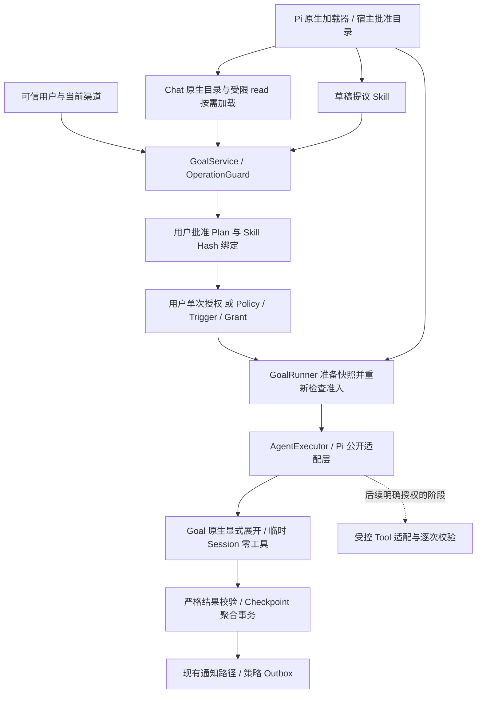

# Personal Agent Skills 与 Tools 扩展设计

日期：2026-10-23。状态：**S0路线已获用户批准并完成代码实施；正式环境仍未启用**。初版设计基线5535260、发布121e83e；本次S0实施从121e83e开始，SDK锁定 `@earendil-works/pi-coding-agent@1.3.0`。前文保留设计依据，实际实现及与建议的差异见第12节，验收见[本轮记录](../evaluations/s0-skills-validation.md)。不重开V3调度开发。

后续S0-A/B/C已通过用户转交的ChatGPT代码审查，发布基线fb5201c。本轮只收紧disable-model-invocation特殊包的明确调用检查，见[独立修复报告](../evaluations/s0-invocation-fix.md)；原验收不改。另交付[Console真实体验方案](../evaluations/s0-console-live-experience-plan.md)和[S1固定只读Web建议](s1-readonly-web-tools.md)，均未执行收费或新增Web能力。

用户已认可 V3.0～V3.3 主要工程阶段性收尾；正式主动执行仍未验收。V3.0.1 的自然语言暂停失败及主模型误解操作收据，继续作为正式主动执行启用前的必解项，原始[复验报告](../evaluations/v3.0.1-live-retest.md)不改。它们不阻塞本文设计。

## 1. 建议与第一批边界

采用**Pi 原生发现/解析/目录/按需加载＋宿主受限读取和授权＋原版 Pi Session**。不自写 Skill 解析器、目录发现器或 Agent Loop。Skill 定义做事的方法，Tool 提供可执行能力；Goal、Policy、Grant 决定是否可以执行。安装 Skill 不授予工具或持续执行权限。

第一批 MVP 先支持两个纯文本 Skill：`agent-notes` 整理用户已经提供的 Agent 技术资料，标注出处和未知项；`interview-practice` 根据已提供的目标与反馈出一道练习。二者不能自行上网、运行测试或写文件。Chat 通过 Pi 原生工具循环按需读取；Goal 产物照旧保存在 Execution/Checkpoint，不自动写 Memory。

推荐两条原生加载路径：**Chat 用受限的原生 read 工具自动按需加载；Goal 在用户指定或草稿选择、审批绑定后，由宿主调用原生 `/skill:name` 显式展开**。前者保留自动识别，后者保留后台零工具、一次模型请求和 text_only。每段 Goal 最多一个 Skill、独立临时 Session、现有输出 Schema，不向主动执行偷渡多轮工具循环。

| 方案 | 优点 | 代价或问题 | 判断 |
| --- | --- | --- | --- |
| 全部直接塞入系统提示 | 改动少 | 无标准包、版本绑定或选择审计；全部占上下文 | 不作为 Skill MVP |
| Pi 原生加载器＋受限 read＋Goal 原生显式展开 | 原生发现/解析/目录/执行均复用；Chat 自动按需，Goal 单请求 | 宿主补范围、版本、预算及审计；受限 read 的覆盖必须验证 | **推荐首批** |
| 无读取工具，仅宿主用公开 `stripFrontmatter`/`context` 投影 | 能保持一次请求 | Chat 需额外路由；原生按需交互不充分 | Goal 的备选，不作为整体首选 |
| 直接开启 Pi CLI 的默认资源、read/bash/MCP | 通用 Skill 可直接寻找文件或运行脚本 | 引入全局发现、任意 I/O、工具循环及新的副作用；突破当前预算与权限 | 不采用 |

首批包括：本地预安装包校验、原生目录/正文、Chat 自动选用、Goal 草稿选择与用户指定、显式计划审批、版本固定、实际使用审计、暂停/失效/恢复与隔离测试。不包括在线安装器、市场、自动更新、模型自行编写 Skill、脚本执行、MCP、Web、任意文件读写、Browser、Sandbox、Computer Use、通用工作流引擎。受限读取只服务获准 Skill 文件，不是通用文件能力。后续能力按第 8 节独立实施。

## 2. Pi 1.3.0 已核实的接口及限制

以下依据本机锁定包的公开声明、随包文档和实现，并对照原项目同版本资料；不根据其他 Agent 的用法猜测 Pi 行为。

| 接口或行为 | 核实结果 | 对本项目的影响 |
| --- | --- | --- |
| `loadSkills({cwd, agentDir, skillPaths, includeDefaults})` / `loadSkillsFromDir` | 包根公开导出；SDK 处理标准格式、扫描、diagnostics | 复用原实现，不写 YAML 或递归 Skill 发现器；只传宿主校验目录 |
| `ResourceLoader.getSkills()` | 返回 `Skill[]` 和 diagnostics；`DefaultResourceLoader` 支持 `additionalSkillPaths`、`skillsOverride` | `noSkills:true` 配合明确 additionalSkillPaths 仍可加载指定包；当前包装器要转发这份原生结果 |
| `Skill` | 包含 name、description、filePath、baseDir、sourceInfo、disableModelInvocation | 没有宿主授权能力或可调用的 `run()`；业务层使用自己的 DTO |
| 渐进加载 | 通常先披露目录，由模型读取正文；`/skill:name` 可显式展开 | Chat 采用受限 read；后台由已批准绑定触发原生显式展开 |
| 自动目录呈现 | 本机 `core/system-prompt.js` 仅在存在 read/bash 或隐藏读入口时生成 Skills 节 | 仅填充 `getSkills()` 不会让本项目零工具 Goal 获得目录 |
| `/skill:name` | SDK 从已登记路径读取正文、剥离 frontmatter 并包裹；需要 `expandPromptTemplates:true` 且命令位于开头 | 当前传 false 且有时间前缀；只为宿主已批准 Goal 新增受控激活分支，不能全局改 true |
| `createReadToolDefinition(cwd,{operations})` | 包根公开导出；`ReadOperations` 提供 access/readFile/detectImageMimeType | 重用原生 Schema/格式化，仅替换底层操作，加前置路径/额度检查；不用完整本机 read |
| `customTools` 的同名覆盖 | 本机工具 registry 中自定义 read 覆盖内置 read，原生 Skills 目录仍识别其名称 | 9项隔离验证已核对；SDK 升级必须复验，不能只看工具名称就认为范围正确 |
| `parseFrontmatter` / `stripFrontmatter` / `parseSkillBlock` | 包根公开导出 | 读取版本/兼容声明、校验展开均用SDK帮助函数，不自写同一套格式解析 |
| frontmatter | 多项无效字段只警告；同名采用先发现项；`allowed-tools` 没有映射成 `Skill` 的执行权限字段 | 宿主必须更严格拒绝无效包、冲突或不支持的能力要求 |
| Pi 专属字段 | `disable-model-invocation` 控制自动可见性，`enableSkillCommands` 控制命令发现 | 都不是宿主授权开关；不能用它们代替默认关闭或 Grant |
| SDK Tools | `tools:[]` 禁用工具；省略白名单会使用默认工具 | 每次构造都显式指定白名单并核对 `getActiveToolNames()` |
| SDK MCP | 1.3.0 已提供 `createMcpExtension()` 等公开工厂，SDK Session 不自动加载这些 CLI 内置扩展 | 不需要声称 Pi 不支持 MCP；本项目首批继续不注册它们 |

官方依据：[Pi 1.3.0 Skills](https://github.com/earendil-works/pi/blob/v1.3.0/packages/coding-agent/docs/skills.md)、[SDK](https://github.com/earendil-works/pi/blob/v1.3.0/packages/coding-agent/docs/sdk.md)、[Skills 示例](https://github.com/earendil-works/pi/blob/v1.3.0/packages/coding-agent/examples/sdk/04-skills.ts)。上述自动目录限制另核对[同版本 system-prompt 源码](https://github.com/earendil-works/pi/blob/v1.3.0/packages/coding-agent/src/core/system-prompt.ts)；只读源码用于核实，不直接调用私有方法。

原生 CLI 默认采用用户/项目资源发现，可能载入 `.pi/skills`、`~/.pi/agent/skills`、`.agents/skills`、显式路径及包资源；默认 Coding Tools 也不是本项目白名单。SDK 可显式传 ResourceLoader/Settings/Tools/Session；无覆盖时仍有默认资源及工具，不能认为“用 SDK 天然安全”。1.3.0 的 CLI 内置 codemode/tool_search/MCP，不等于 SDK 自动注册它们。本项目只保留宿主已有可信内联扩展。

当前 `pi-executor.ts` 的 `noSkills:true`、`getSkills:[]` 和 `noExtensions/noContextFiles/...` 是原来 Task/Goal 零工具、资源隔离的有意边界，不是忘接一个 SDK 开关。最小改动是仅在新 Skill 功能开启时，向私有 loader 传明确路径并转发筛选后的原生 Skills；关闭时保持旧分支。不能直接删 no* 选项或恢复所有默认发现。

包采用标准目录 `name/SKILL.md`，保留 YAML name/description 和可选 references/assets。[Agent Skills 规范](https://agentskills.io/specification)的 `allowed-tools` 仍为实验性字段；本项目将其视为兼容性声明，不接受包作者自授权限。`disable-model-invocation` 是 Pi 扩展，不冒充通用标准必填字段。[官方客户端接入指南](https://agentskills.io/client-implementation/adding-skills-support)允许无文件工具的宿主主动注入正文，因此无需为了格式兼容开放通用文件读取。

## 3. 职责与调用关系

| 概念 | 负责什么 | 不能负责什么 |
| --- | --- | --- |
| Skill | 可复用操作说明、方法、参考资料和模板 | 授权、调度、可信身份、工具实现、自己的常驻 Agent Loop |
| Tool | 有 Schema 的具体操作，由宿主实现和校验参数 | 因模型选择或 Skill 声明而自行扩大权限 |
| MCP | 连接远端或子进程所提供的工具/资源的协议与适配方式 | 替代宿主权限、预算或隔离；server 自述只读不构成证明 |
| Memory | 用户明确保存的知识；Procedural 也只是知识 | 自动变成可执行 Skill、安装来源或持续授权 |
| Goal / Plan / Step | 目标、审批过的工作范围、步骤及进度 | 直接授予全机器或全网络访问 |
| Policy / Trigger / Grant | 可信用户批准的持续策略、一次唤醒与消费记录 | 被模型、Memory、网页或 commit message 创建/扩权 |
| Pi Session | 在给定上下文与工具内运行原版 Loop | 替代 SQLite 状态、Checkpoint 或用户确认 |

建议只增加小的宿主 `SkillCatalog` 服务和业务 DTO，负责安装批准清单、权限、Hash 与读取范围；**其扫描与格式解析委托 SDK**。Pi 导入继续集中在 `pi-executor.ts` 和新的受限工具适配层，业务服务不接触 Pi Session、Model 或私有对象；不做插件依赖注入框架，也不建立第二套 Loop。

## 4. 发现、安装、激活与复用

### 4.1 宿主目录与版本

拟议新增 `SKILLS_ENABLED=false`，独立于现有 `GOAL_ENABLED=false`、`PROACTIVE_ENABLED=false`；它仅允许 Skill 支持，不激活 Goal 或主动策略。具体名称为设计建议，本轮没有新增配置项。

首批仅从专用目录 `<DATABASE_PATH>.skills` 读取经人工审查的本地包；不扫描 `~/.pi`、`~/.agents`、Codex Skills、项目祖先目录或任意仓库中的 `.agents/skills`。安装/启用/更新在停服期间由宿主操作者完成，不调用 npm/git 安装钩子、不联网、不执行包脚本。运行中无热更新；查看目录可用拟议 Console `/skills list`、`/skills show name@hash`，不会调用模型。

宿主清单是独立于标准包的本地配置，记录 ID、来源/版本说明、包 Hash、启用状态、支持 profile、批准的资源相对路径。**宿主清单不是新 Skill 标准，也不是模型可写文件。** 同名包、格式告警、缺字段、名称与目录不符、未知执行依赖均拒绝启用；保留来源与许可证信息，不做静默覆盖。停服后升级生成新 Hash，旧 Plan 不自动使用新包。

在调用 SDK 目录加载前，先验证受管目录及每级组件：禁止符号链接、Windows junction/reparse point、路径穿越、绝对资源路径、设备/ADS 路径和不受管硬链接别名；只接受宿主复制、校验后的普通文件。宿主遍历包内文件仅用于安全校验、容量与Hash，Skill发现/解析仍交给SDK。目录树有深度/数量/字节硬上限；建议首批最多8包、每包16文件/128 KiB，拒绝超限，不能在执行门内递归扫描整台电脑。对同账户恶意进程改写磁盘不承诺OS级隔离。

包 Hash 覆盖规范化相对路径、有序文件字节及宿主资源清单/profile 的确定性摘要；不用作者填写的 version 代替。SDK `loadSkills(...includeDefaults:false)` 或 `DefaultResourceLoader(noSkills:true,additionalSkillPaths:[明确路径])` 只接收这份受管快照。前者适合校验，后者用于 Session 的标准接入；不同时写两套发现流程。正文与批准资源形成有界不可变快照后再使用，模型给路径只能查询已批准映射，不能打开任意新文件。

### 4.2 Chat：原生渐进加载与受限 read

Chat 的 ResourceLoader 返回当前批准集合，工具白名单在既有工具之外只增加一个**受限实现的 `read`**。Pi 原生目录自动进入 system prompt，只有名称/描述/位置，不预装所有正文；模型匹配后调用 read，原版 Loop 收到正文再继续回答。没有另一个“Skill 路由模型”或自行驱动的循环。

优先用公开 `createReadToolDefinition`，复用它的 Schema、文本分页/格式化。提供全部自定义 operations：access 和 readFile 只查询本轮批准的字节快照，detectImageMimeType 固定返回 null，禁止图片读取。外围 execute 先检查原始参数的路径、资源映射、字节/次数/身份及取消状态，再委托原生 execute。该 customTools read 同名覆盖内置 read；显式白名单并验证实际调用拒绝越权，不能仅核对名称。

**前置校验不可省略**：本机 read 源码先调用 `resolveReadPathAsync`，然后才调用自定义 access；前者会探测文件存在性。只覆盖 operations 不够，必须在调用原生 execute 前拒绝映射之外的原始路径，防止探测任意本机文件。SDK 的 `cwd` 也不是沙箱。输入 `..`、UNC/设备/ADS/不受管绝对路径、未经批准链接/资源均拒绝；获准条目使用固定路径与内存字节，不给模型错误回退到内置读取的机会。

建议每轮最多激活2个 Skill、读取2次，正文/参考合计最多8 KiB，候选目录最多2 KiB。超限报错并结束或澄清，不无限分页/递归跟随资源。不支持的脚本/网络要求明确说明，不能因为正文提到 bash 而注册工具。Chat 原有 Task/Memory 工具仍各自走 Guard；Skill 内容不进入授权解析器，不构成新的用户写入意图。

Chat持久Session保存原生工具结果，首批以累计额度限制正文增长：Session custom entry保存ID/Hash和累计正文读取字节。**每Session正文累计最多8 KiB**，重复读取也计额度，不因旧元数据存在就虚假宣称正文已经可用；重启恢复，不自动清零。额度不足仅返回Skill读取拒绝，正常对话与旧工具仍可用，用户可自行另开Session；不删历史或启用收费压缩。新包Hash不沿用旧激活权限，当前模型请求总容量另有硬检查，不重写Pi会话裁剪机制。

原版 read 默认最多50 KiB/2000行，远大于上述产品上限，不能直接照搬；应在快照生成及 execute 外层先限额。不能把 SDK 的分页提示或“Use bash”建议视为授予 bash 权限。

### 4.3 手动 Goal：用户指定或草稿阶段自动选择

1. 用户可明确指定已启用 Skill；未指定时，宿主向计划草稿请求提供批准且兼容 `text_only` 的目录，模型自动提议。目录格式复用公开 `formatSkillsForPrompt(...,'indirect')`，同时明确此时只能提议、审批后才激活；不能为了让 SDK 自动呈现目录给后台加 read。建议目录最多1024 UTF-8字节，过大要求缩小，不悄悄删项。
2. 模型可在 `proposedPlan` 的各步骤中提出可选 Skill ID；这里只是提议。宿主映射为当前受管包及 Hash，拒绝不存在、禁用、冲突或要求工具的包；`disable-model-invocation:true` 的包只接受当前用户明确指定，不允许模型自动选择。
3. 宿主显示待批计划、每步使用哪个 Skill/版本、输入来源、无工具范围。Skill 绑定进入草稿 Hash；只有成功展示后的明确批准才生效。审批保留当前身份、单操作、清单、TTL、版本和目标交集检查。
4. 正式 Step 最多绑定一个 Skill，也允许不绑定；无明确选择就继续普通零工具执行，不能随机挑一个。已批准绑定不能在本段临时换包。需要改选时形成新 Plan 草稿，重新显示、审批；多目标/含糊指代照旧澄清。
5. 执行时才激活选中包正文。后台首批只接受自包含文本 Skill，所需输入由已有 Goal/Checkpoint/Memory/Observation 提供；需要执行中读参考、脚本或网络的 Skill 对该场景报不兼容。Chat 可读批准的静态参考，不意味着后台也获得相同工具。

这将“受控选择”放在现有计划形成/审批链内，执行时不另加收费路由请求，也不让每个模型工具回合任意切换 Skill。以后若需要执行中选择多个 Skill，必须另做有界工具阶段，而不是悄悄修改首批保证。

### 4.4 主动 Goal：原生显式展开、零工具与复用

主动 Goal 使用同样的已审批 Step 绑定，另外保留 Policy/Grant 的独立授权。宿主为本次 Execution 准备受管临时目录中的已核对原始 SKILL.md 副本，loader 仅登记该一个 Skill；再通过**公开** `session.prompt('/skill:已核验名称 ...', {expandPromptTemplates:true})` 让 Pi 自己剥离 frontmatter、加载及构造 Skill 块。命令位于最开头，时间/Goal快照/结果Schema置于参数部分。

这是宿主构造的内部激活，不是将任意用户原文当命令执行。普通 Chat/Task 继续 `expandPromptTemplates:false`；Goal 无 Skill 也保留旧分支。新分支的 getPrompts 仍为空，Extensions 仍只允许宿主代码，不启用默认资源或任意 slash command。Goal 实际工具仍为空，当前对工具输出/第二模型请求的拦截保持。

原生显式展开直接读取 loader 登记路径，**不会经过受限 read**。因此批准目录、只登记本次 Skill、执行副本/Hash和原始输入保留是必要前提；不能用“有一个受限工具”掩盖此入口。展开失败可能原样回退，宿主需在发模型前用公开 `parseSkillBlock` / `stripFrontmatter` 核对实际展开的名称/正文及本次快照；不匹配 abort，不能静默无 Skill 执行。这一失败关闭检查待产品集成验收。

临时副本只是宿主运行资料，不是给模型开放文件写工具，不替代持久 Execution。不能从已展开的内容获得新的权限；系统规则、用户目标、Schema和停止条件优先，真正能力仍由零工具及宿主验证限制。无需访问或修改 `agent.state.messages`，不调用 `_expandSkillCommand` 等私有方法。公开 `stripFrontmatter` 加 `context` 投影可作为备用接法，但不为同一包再写自有解析器。

每段新建 `SessionManager.inMemory()`，结束释放。复用的是同一已批准包 Hash，不复用正在运行的 Session、工具回放或旧权限。跨重启从 Plan 绑定和 Execution 快照核对版本；不是从历史聊天重新推断授权。结果仍必须满足 `goalResultSchema`，Skill 自带输出格式不能覆盖它。已有成果不因换 Skill、包升级或投递失败重新执行。

## 5. 与 V3 的接口、事务及数据兼容

以下是拟议契约，尚不存在于源码。

| 接口或数据 | 首批增量 | 检查者 |
| --- | --- | --- |
| `SkillCatalog` | 有界 list/get；按 ID+Hash 产生不可变正文/参考快照 | 宿主；不向模型暴露文件系统读方法 |
| `GoalPlanSpec` | 可选 `skillBindings: [{stepId, skillId, packageHash}]` | GoalService/Store 校验，纳入原 Plan Hash |
| 计划模型提议 | 每步可选 Skill ID，不允许模型指定磁盘路径、工具、授权或可信 Hash | 宿主解析/映射后再形成正式草稿 |
| `GoalExecutionInput` | 可选 `skill`，保存 ID、声明版本（若有）、包 Hash、绑定摘要、原始SKILL.md字节及原生展开预期摘要 | claim 事务冻结，纳入原 inputHash |
| `ExecutionRequest` | 可选宿主 `skill` DTO，仅传已冻结内容与标识；Chat用本轮批准目录快照 | GoalRunner/可信宿主设置，不由模型工具参数填写 |
| Checkpoint / Run Events | Goal沿 executionRunId 追溯Skill输入及实际展开/使用事件；Chat按当前Run记skill_activated ID/version/Hash/字节数 | 不新建Skill任务表或进度事实源；记录成功读取/展开，不能把目录可见写成实际使用 |
| Policy/Grant | 首批仍 `text_only`；已有 Plan revision 隐含绑定已审批 Skill；不增加任何工具 scope | 原 Policy 归属、版本、期限和预算检查 |

首批只扩展新 JSON 的可选字段，不新增 SQLite 表或改变现有四表职责。旧 Plan/Execution 缺字段表示未使用 Skill；其原始 JSON、Hash、已完成 Step 和 Checkpoint 不回填、不重新序列化。新字段必须进入严格校验与容量限制，不能只给 TS 类型加属性。Plan v0 不执行 Skill，只允许提议后经正式审批绑定。

绑定变更产生新 Plan revision 并使旧策略失效，不在已批准 Plan 上原地补字段。不能给 completed/superseded Step 补绑定；正确复用的已完成步骤照旧保留。Skill 不变也不能借审批扩大原目标或规避数量约束；Step 的四个业务字段改变时沿用现有新 Step ID 规则。

仅保证新版向前读取旧数据；含新 Skill 绑定的库不承诺可由旧二进制安全降级运行，旧程序可能忽略新 JSON 字段。实际实施须停服备份，回退用对应旧库快照，不把“无 DDL”宣传成可随意降级。

建议执行链：

1. 读取 Goal/Plan，门外准备小型 Skill 快照，验证包 Hash、资源边界与 profile；失败不降级成无 Skill、不联网。运行中不热更新目录，避免文件清单与 SQLite 之间再造分布式事务。
2. 重新获取现有 BackgroundLane，保留前台、旧 Task 到期优先检查；比较准备时的 Goal revision/Plan Hash。变化则丢弃预备快照，不能抢领新状态。
3. 在原 claim 事务内核对 Plan 绑定、快照 Hash 和当前授权，再消费 Grant/预算、新建 Run/Execution，冻结 skill 输入。事务内不读目录、不做网络、不调用模型。
4. PiExecutor 核对工具集合为空，按4.4节调用原生展开，继续独立Memory投影；实际展开内容先校验。Goal原始Skill文本建议最多4096 UTF-8字节；最终仍按实际provider payload执行32768字节硬限和4096输出Token限制。超限阻塞，不能裁掉用户约束、扩大预算或自动修JSON重试。
5. 原版 Pi 一段执行后检查 `agent_settled`、中断、模型/工具错误及 Schema。原事务写 Run/Execution/Step/Goal/Checkpoint；Policy 再决定下一 Grant 与通知 Outbox。Skill 不自建 checkpoint 文件或续跑队列。
6. 暂停、取消或策略撤销先撤销提交权再 abort；迟到结果仍 discarded。停服/崩溃中的 running 仍阻塞，不因为 Skill 文本“继续”而补跑。已提交结果只查询或重投通知。

首批目录禁用/升级在停服后发生，重启时每次领取前核对已绑定包：缺失、禁用或 Hash 不符就阻塞该 Goal，不领取旧 Grant。运行中希望立即停止使用该 Skill 的 Goal，必须调用既有 Goal 暂停或策略撤销，不只改一份文件。以后若加热撤销，须持久化权限版本并接入同样的提交校验，不能仅移除 UI 工具。

## 6. 权限与确认

首批 Goal Skill 只是 `text_only` 的输入方法，不能从 Skill/Memory/Observation/工具结果中生成新的 Grant。旧 Task 保持无工具；Chat只在Skill开关开启时附加受限read，已有Task/Memory工具的授权语义不变，后台也不能借Skill调用goal_manage、修改Policy或写Memory。

以后每个可执行工具都要有宿主定义的能力描述：稳定 tool ID、实现版本、输入 Schema、读写性质、资源范围、超时/调用次数/输出容量、取消方式和恢复方式。批准范围取以下各项**交集**，任一缺失即拒绝：

`宿主已启用能力 ∩ 用户批准的 Goal/Plan/Policy 范围 ∩ 本次 Grant ∩ 当前 Skill 兼容要求 ∩ 具体参数资源范围`

SDK 工具白名单仅是第一层；每个真实工具的执行方法仍检查上下文。只让适配层通过闭包持有 owner/channel、Goal/Plan/Execution、Policy/Grant、权限版本、截止时间和预算令牌；不让模型填写这些权威字段。后台不继承交互 AsyncLocalStorage 中的写权限。

| 操作 | 首批处理 | 后续确认规则 |
| --- | --- | --- |
| 使用已批准的纯文本 Skill | 与已展示的 Plan 一起批准，单次/策略授权仍照旧 | 不为每次参考加载反复确认 |
| 新 Skill/新 Hash/改能力 | 新草稿、重新展示并批准；停服安装 | 安装或旧聊天均不能自动批准升级 |
| 只读 Web/文件 | 不提供 | 先明确允许域/目录、目的与数据外发范围；只读也有隐私风险 |
| 写文件/发布/支付/账号操作 | 不提供 | 具体操作草稿与目标、参数 Hash、版本、时限、成功展示记录；当前可信用户一次确认 |
| 模型认为需要新权限 | blocked 并说明缺少什么 | 模型不能替用户确认，不能用“继续”批准未展示的高风险动作 |

未来具体外部写确认采取“准备并展示 → 结束本段等待 → 当前用户明确确认 → 宿主核对并一次消费”，不让临时 Pi Session 长时间悬挂等用户。确认凭据绑定身份、渠道、Goal/Plan、目标资源/旧版本、参数与预览 Hash、有效期、来源和消费记录；任何变动重新确认，多操作逐项清楚列出。本设计不开放这些写能力，也不把 Policy 的一次审批扩展为任意外部副作用许可。

## 7. 失败、预算与外部副作用恢复

| 故障窗口 | 必须采取的行为 |
| --- | --- |
| Skill 不存在/格式无效/包 Hash 变化/资源越界 | 模型请求前阻塞；无静默换包、跳过 Skill 或收费修复 |
| 加载后的请求超容量 | 在 provider 发出前阻止；费用预留按现有保守规则，不因本地失败自动放宽 |
| 模型 Schema 错误、截断或自称完成 | 失败或等待，继续原 Goal 规则；不自动再调一次改 JSON |
| pause/cancel/revoke 与迟到结果竞争 | 先持久化控制版本，abort 协作终止，提交 CAS 拒绝旧结果 |
| 已提交 Checkpoint 后通知失败 | 只走原通知恢复，不重做 Skill/Step；可能重复、迟到或最终失败 |
| 崩溃前模型运行、没有完整提交 | 重启 blocked/interrupted；核对证据，不自动重放 |
| 未来工具已发出但回执丢失 | durable uncertain，停止推进；核对外部状态，不能通过重跑整个 Step 猜是否成功 |

当前 V3 用一次请求的最坏输入/输出预留每段额度。**工具循环通常需要多次模型 HTTP；不能沿用“一次 Execution 算一次调用”。** 首批不改变此不变量。后续工具阶段必须在每次真实模型 HTTP 发出前持久预留调用与费用，并同时限制单段请求数、工具次数、总时长/资源量、每日及全局上限；目录选择、工具结果后的模型轮、压缩、查询改写和重试都不能漏计。未知费率/无法截获的隐式请求阻塞；自动重试保持关闭，不额外建立昂贵路由器。

Chat 的原生按需加载已实测需要两次模型 HTTP，不得宣传整个 MVP 都一次请求。建议Skill启用的Chat每轮设置主Loop与辅助请求共用的硬调用上限（初始建议8次、read至多2次、原执行超时不变），覆盖意图解析和已有Memory改写，超限在HTTP前停止且不重试；不为选Skill再加分类器。该Chat计数不借用或清空主动Policy账本，未知cost如实记录；不能把普通启动误说成有人民币账单硬上限。主动Goal继续原独立Grant/预留及一次HTTP，首批不改其账本算法。

未来外部工具需新增最小调用账本，而非依靠 Pi toolCallId 或 Session 回放：至少保存 Execution、业务幂等键、权限/参数 Hash、prepared/in_flight/succeeded/failed/uncertain、回执摘要。副作用发出前先落盘；返回后记录，再由 Checkpoint 引用。中途暂停不能撤销已经发生的写入，要保留真实结果供核对，但拒绝继续 Goal 或产生新授权。

本地 SQLite 不能与外部系统原子提交。有可核对幂等接口才考虑按相同业务键恢复；没有则 uncertain 后等人处理，不盲目重试。通知 Outbox 只负责通知，不能拿来自动重放发布、文件写入或付款。不能宣称任意工具 exactly-once，也不能因读取失败就断言写入未发生。

## 8. Web、文件、Sandbox、Computer Use 与 MCP 的实施顺序

这些是后续设计方向，**不是本轮授权或首批必做**。每级有独立默认关闭开关及逐 Goal 范围，开启上一级不会自动开启下一级。

| 阶段 | 最小能力 | 进入条件与边界 |
| --- | --- | --- |
| S0：首批 Skills MVP | 原生加载器、Chat受限read、Goal计划绑定/原生展开 | Goal仍零工具/单请求，Chat有界工具循环；两份自有Skill，Console隔离测试；无包脚本/网络安装 |
| S1：受控只读 Tools | 先固定文档域 Web fetch，及明确资料目录的文本读取 | 新只读执行 profile、逐 HTTP 预算、工具调用账本和完整恢复测试先就绪；两项分开开启 |
| S2：受管产物文件 | 专用 artifacts 目录创建新成果文件，后续才考虑显式替换 | 预览/Hash/目标范围、原子写与对账、禁止任意删除/覆盖；不写源码、Memory 或正式目录 |
| S3：Sandbox 脚本 | 审核后的特定脚本，在独立 OS 隔离进程执行 | 单独批准隔离后端；无宿主凭据、网络默认拒绝、只读输入/独立输出，CPU/内存/进程/磁盘/时间限额 |
| S4：交互式 Computer Use | 单应用/专用会话的观察与有限操作 | 另行安全设计和授权；先用户在场，逐次高风险确认，不能默认挂到主动策略 |
| 可选 MCP 适配 | 已批准 server 的固定只读工具映射到同一宿主 Tool 接口 | 不因支持 Skill 而连接 MCP；不用全局 mcp.json 或通配符自动放行 |

Web：宿主固定允许域、协议和动作，不提供任意 fetch 代理。拒绝本机/内网/link-local/云元数据地址，逐次校验 DNS 与重定向目标，限制响应字节、内容类型、超时和外发数据；不携带浏览器 Cookie 或正式账号凭据。正文带来源与读取时间，低信任，不自动跟链接扩大范围。模拟测试用宿主注入本机 HTTP，不能把生产 SSRF 校验关闭。

文件：路径解析、实际根目录、符号链接/junction、大小与敏感文件校验由宿主执行，避免检查后换链接。给模型资源 ID 而非任意机器路径。读取批准文件意味着允许向模型服务披露其内容，审批需要讲清楚；写入只限独立产物区，覆盖检查旧 Hash。文件系统与 SQLite 仍无跨存储事务，采用临时文件/目标 Hash 对账，不能因 DB 回执失败重复写入。

Sandbox：工具白名单、cwd 和 Node `vm` 都不构成 OS 安全边界。只在用户另行认可的可用隔离后端上实现；Windows/Linux 的隔离机制不能假设等价。无可验证隔离就拒绝脚本，不退回宿主 Shell。首批不因“标准 Skill 常带脚本”便引入容器常驻服务或开放 bash。

Computer Use：截图也可能读取隐私，点击也可能产生外部副作用；需要窗口/账户绑定、截图范围、步数/时长、当前屏幕确认及可中止性。网页/屏幕文字均低信任，不构成用户指令。付款、发布、发消息、权限变更和正式账号操作仍单独确认；超时/页面跳转造成未知结果时停止，不能盲点重放。

MCP：协议提供连接和工具描述，不提供本产品的权限保证；[MCP 工具规范](https://modelcontextprotocol.io/specification/2025-11-25/server/tools)也要求谨慎对待不可信 annotations。Pi 1.3.0 的[原生 MCP 扩展](https://github.com/earendil-works/pi/blob/v1.3.0/packages/coding-agent/docs/mcp.md)具备动态连接、工具变化及传输重试行为，不能直接接到当前精确限额链。后续优先一个可信只读 server，固定端点/进程版本、凭据范围及工具 Schema Hash；变更需重批。stdio 启动本身就是代码执行，HTTP 连接也会暴露身份/数据，不应先连接所有 server 再筛工具。所有调用必须经过同一宿主校验；无须在首批新建 MCP 管理平台。

后续Goal只读/写入profile不能伪装为原text_only。当前goal_executions.capabilityClass的SQLite CHECK及Policy类型仅允许text_only；若决定让Goal也动态调用read（即使只读Skill），就需先单独批准能力/逐HTTP预算语义及兼容迁移，不能只改TS union或把工具藏在扩展里。推荐S0不走这条扩权路线。

## 9. 实施批次与验收计划

下表为未来产品编码验收要求；本轮只执行第10节的小型SDK技术验证，未完成以下产品集成。优先S0-A → S0-B → S0-C，不同时实现后续工具阶段。

| 批次 | 最小改动位置（拟议） | 通过条件 |
| --- | --- | --- |
| S0-A 原生加载与Chat | 小型SkillCatalog/业务类型、config、pi-executor、受限read适配、两份标准包 | 默认关闭零发现；原生目录/正文自动加载；路径/调用量/历史上下文限额；失败不回落任意read；Hash可复核 |
| S0-B 计划与宿主授权 | goal-types/store/service、Guard 的草稿/审批投影 | 模型只能提议目录内 ID；用户成功看到具体绑定后才能批准；新 Plan Hash/CAS、一次操作及完成步骤不变 |
| S0-C Goal执行与恢复 | contracts、GoalRunner快照准备、pi-executor原生显式展开适配、Run Events | 真实SQLite＋原版Pi＋本机模拟模型；Goal仍一次HTTP/零工具；策略/控制/Checkpoint/预算/通知和旧能力回归 |

核心测试矩阵：

| 类别 | 必须断言 |
| --- | --- |
| 目录 | 开关关闭不读取目录；仅受管包被 SDK 发现；恶意同名、缺描述、告警、过深/过大、路径穿越、符号链接/junction、硬链接别名和敏感文件均被拒绝；拒绝不产生模型请求 |
| 标准兼容 | 标准 SKILL.md 原样可在 Pi 公开加载器解析；支持的 reference 有明确边界；不支持的脚本/工具需求明确报错；无需自创正文格式或修改 SDK |
| 选择 | 草稿提议未授权；不存在/禁用/显式调用专属 Skill 不可自动选；多个目标或含糊选择澄清；Memory/commit 中“启用某 Skill”无权限 |
| 计划 | 已展示草稿 Hash、身份/渠道/TTL/revision 不匹配拒绝；绑定变化需要新审批；数量约束、旧 Plan Hash、完成 Step 与 Checkpoint 保留 |
| Pi真实路径 | Chat第一请求只有目录，read后第二请求才有正文，越权请求走受限实现而非内置回退；Goal只展开批准包、零工具/一次HTTP，未展开或Hash错须网络前拒绝 |
| 容量/预算 | 正文/目录/参考及最终 provider payload 超限均在网络前拒绝；第二 HTTP、SDK 重试、跨重启额度重置不能发生；未知费率阻塞策略 |
| 场景A Chat | 用已提供资料，模型在批准集合选agent-notes并按需read；正文与参考去重、禁用/升级不沿用历史授权；普通陈述/低信任指令不触发Memory写入 |
| 场景B 手动/主动Goal | 用户指定或草稿自动提议interview-practice，审批绑定；手动一段/模拟时间策略分别生成一题并Checkpoint等待；重启不重复触发，反馈未到不能继续；可复用已有本机Observer桩验证外部注入无权 |
| 场景 C 控制/复用 | 多个合法片段复用同一 Hash、各用独立 Session/Execution；暂停/撤销后迟到结果 discarded；升级/禁用后不继续使用旧策略或静默换包 |
| 崩溃/通知 | running 重启阻塞；提交返回异常重读；Checkpoint 已提交/通知发送失败只重投通知，不重跑 Skill；通知故障不冒充执行失败 |
| 既有回归 | Task 一次性、Session 隔离、Memory/Formation 写入权限、原 Goal/Policy 限额与后台门行为保持；无需重新造一个调度器 |

将来编码每个批次运行适用 typecheck/build/test 与两个 eval；完整阶段在 Windows 和隔离 Linux 用相同源码跑，记录各平台跳过项。观察只用本机 HTTP，模型用模拟服务，SQLite 用新临时库，不改冻结预期或历史证据。对于已有后台门测试，运行已有回归即可，不额外重复一轮同构慢网络研究。

正式启用前另设质量门槛：先解决 V3.0.1 自然暂停与操作收据误解，并用冻结原话做离线及另行批准的真实复验；再完成 S0 的真实选择/正文遵循/中断与收据验收、主动执行真实验收及适用渠道验收。Console 模拟成功不等于手机、真实模型或长期主动运行通过。两项 V3.0.1 问题不由 Skill 提示词“顺便修复”，必须保留原始失败与独立证据。

## 10. 设计阶段的隔离技术验证（实施前历史）

本节“本轮”指初版调研阶段，S0产品实施与新验收见第12节，不覆盖本节原始证据。

使用[一次性脚本](../evaluations/fixtures/pi-native-skills-spike.mjs)，只创建临时虚构Skill/私有标记文件，运行原版SDK和127.0.0.1模拟模型。Windows Node24.19.0、Pi1.3.0最终运行9项通过、6次本机HTTP；两轮完成运行累计12次本机HTTP，收费0；没有接入正式Chat/Goal或SQLite。详见[独立报告](../evaluations/pi-native-skills-spike.md)。模拟模型按预置返回，不证明真实模型自动选择或遵循Skill的质量。

9项包括原生发现/解析与目录隔离、目录与正文渐进呈现、实际read工具循环、任意路径拒绝且不回落内置read、路径穿越/链接别名/取消、批准参考读取、零工具原生显式展开、当前适配器不能展开的事实、禁用过滤。其中某些为同项多个断言，不以断言数充当测试数。初版验证脚本误用require.resolve解析仅ESM导出的包，启动即失败；已保留原始失败，改标准ESM import后通过，不是SDK业务失败。

本轮没有新增产品源码、依赖、迁移、开关或正式工具，没有收费/正式账号/正式数据/.env操作。未运行整套typecheck/build/test/两个eval或Linux回归；本次仅设计与隔离SDK验证，不把历史249项当新测试。

## 11. 已批准的取舍与实施入口

建议产品修改文件（均未实施）：

| 文件 | 最小职责/接口 |
| --- | --- |
| `src/skill-service.ts`（拟新增） | 宿主批准清单、ID/版本/Hash、受管资源和有界快照；委托Pi适配层发现/解析 |
| `src/skill-tools.ts`（拟新增适配层） | 公开createReadToolDefinition＋宿主前置检查/ReadOperations，不实现通用文件服务 |
| `src/pi-executor.ts` | 私有DefaultResourceLoader显式路径、原生结果转发、Chat受限read与有界调用、Goal原生展开及校验 |
| `src/contracts.ts`、`src/config.ts`、`src/main.ts` | 宿主Skill DTO、默认关闭配置和服务组装；不向业务层泄露Pi类型 |
| `src/goal-types.ts`、`src/goal-store.ts` | 可选绑定/执行快照，严格校验和Hash；原四表与Checkpoint原子性不变 |
| `src/goal-service.ts`、`src/operation-guard.ts`、`src/goal-runner.ts` | 显示/审批绑定、单操作授权、门外准备与领取核对、实际使用审计 |
| `skills/agent-notes/SKILL.md`、`skills/interview-practice/SKILL.md`（拟新增） | 两份标准自包含低风险包；发布资源不等于自动安装或启用 |
| `tests/skills-loader.test.ts`、`tests/skill-tools.test.ts`、`tests/skills-integration.test.ts`、`tests/goal-skills.test.ts`（拟新增） | 原生SDK与资源隔离、Chat闭环、真实SQLite下Goal/Policy/控制/恢复 |
| `.env.example`、README、PROJECT、STATE | 只有实施后才补配置/运行指引；正式.env不改 |

首批无需修改TaskScheduler、BackgroundLane、Memory/Formation核心、Pi包或node_modules。辅助模型请求的调用计数可在现有适配函数入口增量接入同一Chat计数对象，不另建计费平台。后续有界工具循环期间也不能随意释放执行门造成并行模型执行；先设总时长和工具超时，任务非抢占性质如实保留，本轮不据此扩展调度器。

用户已批准S0：两个自有纯文本包、Chat原生按需read、Goal审批绑定和原生显式展开及完整隔离验收。产品权限仍默认关闭。采用**Chat有界多轮读取、Goal只在审批范围内激活固定Skill**；后台执行中动态选读影响原text_only/一次HTTP承诺，不默认实施。

不需要新框架或持久化服务。首批使用现有JSON、Run Events与应用事务，目录批准清单用普通宿主文件；无运行中全局热安装/启用。MCP、脚本、Web和Computer Use均未获得授权，仍后置。

## 12. S0实际实现与核对

S0-A由 `skill-service.ts` 校验宿主批准清单、普通文本资源、目录边界和Hash；`skill-tools.ts`复用原生loadSkills/parseFrontmatter/createReadToolDefinition/defineTool，前置参数检查避免原生read探测任意路径，ReadOperations只返回批准字节。`skills-admin.ts`是停服人工入口，Console支持只读/skills和/skill ID；模型无安装或清单写工具。两份自包含包已落盘，未安装到正式目录。

Chat真正走原版Pi工具循环，目录先进入Context，read后下一请求才有正文；每轮read2次、累计正文8192字节、每轮主Loop及辅助模型HTTP共8次、最终payload65536字节。次数和额度超限不收费重试；正文额度不足只拒绝read，正常聊天仍能继续。与初稿“缓存命中即返回已加载”的建议不同，实际选择重复读取也扣额，以避免崩溃或缺失工具结果时假称正文仍可用。这不改变授权范围。

S0-B在原Plan JSON新增可选skillBindings，模型proposedPlan每步仅增加可选skillId（null表示移除），宿主映射版本和Hash。用户明确指定的包不可被模型替换；待批与正式计划逐步显示绑定或无绑定，已有成功展示/TTL/owner/channel/revision/draftHash检查完整保留。当前步骤改绑或移除只是revise_plan草稿；完成Step禁止改绑定，旧JSON及Hash不回填。批准前在事务外核对包，再按原CAS事务批准。

S0-C在门外准备批准包快照，门内保留Task优先与再次版本核对，claim原子保存SkillSnapshot到Execution.input并纳入inputHash。创建私有临时副本，loader仅登记该一包，公开session.prompt以/skill开头、时间和Goal输入放在参数部分，只为该宿主分支开启expandPromptTemplates。context中用公开parseSkillBlock/stripFrontmatter核对名称/位置/全文/参数，provider前再核对当前Hash和容量/次数，实际工具集合为空。执行后再次核对未禁用或变化；原Checkpoint和策略Outbox事务不变，不重放模型或外部工具。

若领取前Skill不可用，则Goal进入既有blocked状态并清除ready授权；尚未领取Step继续pending，不虚构失败Execution或消耗Grant/预算，修复后需明确新计划/新授权。改包不能静默替换Hash。若运行中禁用/变更，结果不能成为新Checkpoint；用户pause/cancel/revoke版本仍优先。进程恢复不盲目重跑，临时Session与本段副本正常释放。

无DDL、依赖或Pi源码修改；旧Task一次性与Memory/Formation语义不变。新增审核和读取是宿主能力，不构成OS沙箱，无法防御同账户恶意进程或管理员篡改；Windows ACL与正式渠道另验。Skill已展开的审计事件只证明进入本段Context，不证明真实模型正确遵循方法。Skills/Goal/Proactive默认仍false；V3.0.1两项真实失败及真实主动执行验收缺口保留。
