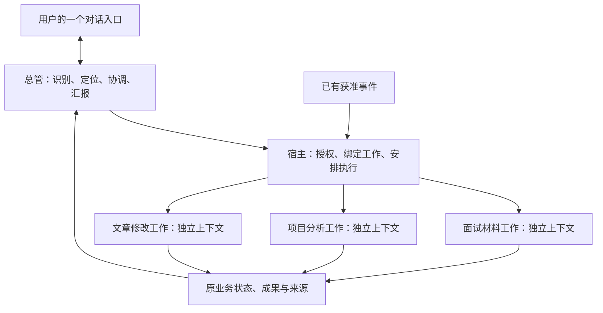

# 总管与独立工作上下文的架构复盘

日期：2026-11-02。状态：**规划与静态审查，待用户批准，不实施代码**。依据是用户本轮重新提供的原四阶段规划、最新澄清，以及当前工作树源码。本文修正此前[对话核心方案](chat-first-interaction-plan.md)的架构与实施优先级；其简洁界面、真实状态和审批原则可以保留，C2/C3及复合请求限制不能直接照旧实施。

## 1 判断

**基础设施仍可复用，但产品实现和完成标准发生了偏移。** 已经有主题关系、多个后台工作的队列、每次执行的独立 Session、事件订阅和有界 Recall；缺的是把这些能力连成总管自动承接、隔离执行、后续消息回原工作、统一交付的持续流程。

偏移有三处：原本让总管决定如何分派，落地成用户选择模式和主题；原本让工作持续保有自己的上下文，落地主要是无历史的单次纯文本 Worker；原本验收连续交代多件事并接着推进，验收重心落在各个模块的独立入口与离线测试。模块测试的价值保留，但不能据此宣布最终个人 Agent 体验完成。

这里不是说后台 Session 没有隔离，也不是说队列只能存一项工作。这两点当前已经具备。主要矛盾是普通 Chat 仍承担具体工作，而独立 Worker 需要显式调用，且没有工作级的自然续接入口。

上一版方案继续让“基于旧成果的修改”进入主 Chat，且把复合请求统一降为“先挑一项”，仍然没有充分解决用户提出的上下文混杂和总管协调问题。那份方案的独立审查通过，仅说明当时文档的代码事实与局部边界自洽，不表示最终产品目标已经覆盖。

## 2 当前事实与原目标的差距

本轮基线：`codex/work-core-stages`，HEAD `d0cfcbc608ace1a79b9938a8c7a782fa80b5958c`。已有 Guard 修复及测试、STATE、交互方案未提交；本轮不修改业务代码、运行实例或这些修复。

| 原目标 | 当前已实现 | 尚未接通 |
| --- | --- | --- |
| 一个总管理解和分派工作 | WorkRouter 的显式 mode 分派、独立的模型建议及确认接口 | 普通发送不调用工作协调；模型建议不是当前自动总管 |
| 工作之间上下文隔离 | work/task/goal 每次独立内存 Session，结束释放；work 不读 Chat 历史或 Memory | 普通 Chat 仍共用持久 Session，直接在里面做的多类工作不会自动隔离 |
| 能连续交代多件事 | WorkJobStore 是多记录 FIFO，WorkRunner 一次领取一项 | 正常聊天不能自动将连续新工作入队；当前 Chat 忙时新 Chat 请求被拒绝，输入仍受 busy 限制 |
| 同一件事能持续修改、补充 | Goal 有原目标、计划、反馈和 Checkpoint 快照续接 | WorkJob 只有创建、查询、取消等接口，没有工作补充输入、续接或按工作恢复 Session 的协议 |
| 总管找到原成果再协调 | WorkRecallService 有确定性定位、归属校验、有界原结果和来源 | Recall 是独立页面/API；无明确对象的“刚才”会澄清，尚未进入总管的日常调用链 |
| 事情完成后统一交付 | Job 结果持久化、主题结果页、收件箱 | 主对话时间线尚未包含 Job/Goal 结果，UI 可见也不等于总管模型收到正确上下文 |
| 外部变化续到原工作 | 固定 GitHub 来源、订阅、原 Policy/Grant 可推进原 Goal | 用户消息、WorkJob 补充、工作完成等还不是完整统一的协调入口；事件底座不能冒充通用事件总管 |

主要源码依据：

- [WorkRouter](../../src/work-router.ts)第75–90行：仅按显式 chat/work mode 分派。
- [PiExecutor](../../src/pi-executor.ts)第150–168行及第518行：Chat 复用持久 Session，其余执行使用内存 Session 并释放。
- [WorkRunner](../../src/work-runner.ts)第52–59行：执行输入只有本次 job.instruction，没有工作历史加载。
- [WorkJobStore](../../src/work-job-store.ts)第43–68行：多个 Job 持久化、FIFO领取；第90–92行：running 重启转 interrupted。
- [WebUiChannel](../../src/web-ui-channel.ts)第144–154行：Chat busy 拒绝及普通 chat 执行；[Web API](../../src/web-ui-server.ts)第210–230行：WorkJob 无补充/续接接口。
- [Goal 投影](../../src/goal-runner.ts)第34–63行：从权威计划、反馈与 Checkpoint 重建有界上下文。
- [Recall](../../src/work-recall.ts)第189–245行及[对话时间线](../../web/src/chat-timeline.ts)：定位边界与当前消息种类。

以上为本轮静态核对，未重新运行工程测试，未读取实际 Session、Memory 或数据库。

## 3 正确的职责划分

图中独立工作不表示第一版同时并行运行。可以先保持原串行后台执行门，同时承接和保存多个互不混淆的工作。

**总管做轻量协调。** 理解当前请求属于新工作、原工作补充、状态查询、控制还是普通交流；找到已有对象，提出执行或查询意图，由宿主核对权限。它保存有界的工作索引、状态、关键决定、摘要和来源引用，不持续装入所有工作的完整材料与执行历史。普通寒暄和简短解释可直接回复；研究、长文整理、持续修改等工作应交给相应执行上下文，不能只靠一句“尽量委派”而仍全部自己做。

**Worker 做具体工作。** 取得这件事的目标、当前输入、必要旧成果、当前有效约束及允许能力。面试工作不收到无关文章和项目历史。Worker 可复用相同模型与公开 Pi SDK；无需先设计十几个角色，也不要求每个 Worker 是另一个微服务。

**宿主保存事实并决定是否允许执行。** 业务状态依旧来自 Task、Goal、Job、Run 等原服务。总管输出不能直接授予权限；当前用户原话与可信来源必须保留给 Guard，摘要、历史和外部事件只是资料。工作中新增权限、目标变化和预算变化仍走原批准边界。

**总管上下文和用户界面分离。** 用户可以在同一界面看到完整成果，但后续给总管模型的输入优先是摘要与引用。原文保留在原请求和成果中，按需授权读取；不因摘要改变 Guard 所验证的原请求。使用 Pi 公开上下文机制，不能改 SDK 内部数组，也不能把所有工作结果自动写成长期 Memory。

## 4 按具体工作隔离，不按任务类型永久分箱

“面试”“写作”“开发”用于选择能力和组织主题，但不是三个永远共享全部历史的大 Session。同一种类型的两个独立项目仍应隔离；同一个工作跨多条消息则应保持身份和约束连续。

WorkThread 是组织容器，一项主题可以包含多个 Goal/Task/Job；不能把一个主题直接等同于一个 Pi Session。Goal 保有长期计划，WorkJob 是一次执行请求，Run 是执行记录，Session 是模型运行上下文，四者生命周期不能混为一谈。

当前无需先新建万能 Task/工作流实体。先复用原对象身份及主题关系；若单次 Job 的后续修改需要前序成果引用，补最小关系元数据。已完成 Job 的结果保持不可变，新修改通过有来源引用的新一次执行关联回去，不能把已完成或已取消的记录改成正在运行。

## 5 独立上下文必须可续接，但不等于永远保活 Session

有两条可以讨论的实现路径：

| 路径 | 优点 | 代价 |
| --- | --- | --- |
| 每项工作有持久 Pi Session | 自然保留多轮细节、公开 SessionManager 可复用 | 需要工作到 Session 的稳定绑定、并发互斥、压缩和权限随状态变化处理；既有一次性 Worker 没有这些机制 |
| 每次从该工作的权威记录重建隔离 Session | 接近现有 Goal 快照模式，状态与上下文边界清晰，可复用当前临时 Session | 必须保存用户补充、版本和必要成果引用，并验证内容预算；只有摘要会丢细节，不能省略关键原文而不标记 |

**推荐先用第二条补齐当前纯文本工作续接，再依据真实任务需要决定是否引入工作级持久 Session。** 这是待批准的技术建议，保留现有 Goal/Task/Job 事实源、取消与恢复语义；旧成果进入后继 Job 的输入契约及最小关系元数据，需另行批准后扩展。判断标准是恢复后拿到正确工作材料、不会串任务、不会自动重放副作用；不是强求所有工作一直占着一个 Session。

“收到补充”与“当前执行已采纳补充”必须区分。现在 work 是单次模型请求，没有中途注入协议。新方案可先将补充作为当前工作待处理输入持久保存，明确告知会在下一轮应用；需要立即停止时沿原取消语义。不得把正在运行的旧结果说成已按后来要求修订。输入版本及下一轮授权在实现前单独冻结；不以本提案授权自动重试或多一轮收费。

## 6 承接能力与执行并发分开设计

必须区分三个问题：

1. **连续多条独立请求。** 用户先交代A，再交代B，无需等A执行完；总管分别定位、保存和回执，原后台门可以串行做。即使总管短暂忙于一次路由，也不能静默丢消息；需要有界接收与明确接收状态，而不是让长任务占住 Chat。
2. **同一句包含多项请求。** 总管应识别并保留每一项，有明确范围与既有许可的事项可以由宿主分别安排；只有歧义、冲突、缺关键信息或缺权限时才问用户。不能因为后台并发为1，就一律让用户挑一项、其余自己记住。
3. **多个 Worker 真正同时执行。** 属于执行资源与能力扩展，可以后做；它不应成为前两项的前提。

现有 Guard 一轮一次操作约束、Job 的 requestId 唯一约束不能简单去掉，也不能对模型拆出的子指令重新开多个 Guard Frame 来伪造多次用户授权。多项承接需要保留原消息、逐项范围证据、稳定子请求身份、每项授权与回执。可以用一次清楚的确认覆盖明确列出的范围，但不能把“同意这份整理”扩展为创建 Goal、联网或保存 Memory。

这是原目标所需的核心协调设计，必须纳入下一份详细任务书并请用户批准。当前代码尚无此契约。本轮既不实现，也不以“最终目标需要”为理由越过审批。

## 7 纠偏后的最小验收主线

下一批建议以“三件事情同时存在并可继续”的一条纵向流程作为交付单位，而不是先做完一个菜单再做下一个菜单。为验证现有能力，先选三份已提供的虚构文字材料，不加联网、文件或外部写权限。

1. 用户从空白对话分别交代面试提纲、项目周报、文章修改。总管自动承接，用户不选模式、不建 Session、不手工建主题；每项有自己的真实记录。后台先串行。
2. 一项执行时继续交代另一项和普通问题；新输入不丢失、不因工作执行长时间拒绝。记录实际接收延迟与响应延迟，不能用已经做完的短工作冒充重叠。
3. 询问“面试那件做到哪了”，读取正确对象的真实状态；补充“面试提纲突出调度”，只关联该工作。另一个工作晚到的结果不能抢走指代。
4. 第一次成果完成后要求修改，下一次隔离执行只拿该工作必要上下文；主协调模型不累计三份全文。测试在模拟模型入站处检查实际材料与身份，不能只看界面标签。
5. 刷新及进程重启后仍可查询各项状态、来源与补充是否已采纳；运行中中断沿原规则，不自动伪装为恢复完成，不自动重跑收费请求。
6. 成果与必要问题统一回到原对话；技术ID和审批详情按需查看。文件/Goal展示授权、通知入箱和用户已读分别记录。
7. 加一个“一句话三项请求”的单独验收，明确逐项范围、批准、部分失败与回执；在契约和用户批准完成前，该项标为未实现，不能算前三条独立消息的测试已经覆盖。
8. 在以上接通后，将已获准的 GitHub 事件接回相应 Goal/工作，验证重复事件和无授权事件；再验跨次引用原事件和成果。普通用户消息接入不能冒用 source-event 的观察许可。

独立审查除权限、错误和恢复外，还要对照原始用户故事核对“人是否仍在代替总管”。保留工程回归，但验收记录需分别报告承接正确率、上下文串用、后续归属、人工选择次数、请求数/费用和真实成果质量。隔离首先解决工作材料混杂与连续性；总管可能增加一次协调调用，不能预先承诺更便宜或更快，需用相同任务比较质量、等待时间和总调用成本。

## 8 保留与修改范围

保留：TypeScript/Node/SQLite、原版 Pi SDK/Loop、Task/Goal/Memory 事实源与权限、WorkThread 关系、Job 队列、Run审计、事件/Policy/Grant和原取消恢复机制。不会因为这次复盘推倒重写。

待设计改动集中在：`web-ui-channel.ts` 与 Web 输入/结果投影的接收链；`work-router.ts` 的协调决策与宿主受控入口；`contracts.ts`/`pi-executor.ts` 的工作上下文接线；原 Job/关系存储中必要的补充输入与前序成果引用；`work-recall.ts` 的按需协调调用。哪些需要增量表/字段、哪些只需既有引用，在详细任务书中确定，不先预建通用消息总线或新状态机。

必须单独批准：主 Chat 转为轻量协调职责的具体方案、新委派与上下文读取入口、复合请求逐项授权、补充输入及下一轮执行语义。后台网络/文件权限、多 Worker 并行、跨渠道身份、正式数据迁移、自动 Memory、可靠外部推送及常驻部署不随本次规划获准。

本轮结论是校准方向，而非宣布新架构已实现。下一步应先按上述主线完成可审查的协调与上下文契约，再拆 Worker 任务；不直接执行此前仅以统一UI入口为首批目标的计划。

## 9 本轮审查与交付边界

两位独立 Subagent 分别复核目标对齐与上下文实现，随后由独立 Reviewer 对本文进行静态审查：PASS，无阻断性事实或设计问题。已采纳输入契约边界的一项可选措辞建议。审查通过只表示本方案与已核对事实自洽，不代替用户批准，也不证明未实现的用户流程已经可用。

本轮只新增本文、在旧交互方案标记修订优先关系，并更新 STATE；不修改业务代码或测试，不操作运行实例、正式数据或 Git 发布。文档校验核对相对链接、UTF-8、差异与受保护文件；未重新运行 typecheck/build/test，未调用模型。独立审查记录保存在本机 `work-core-stages/superagent-alignment/` 证据目录。
