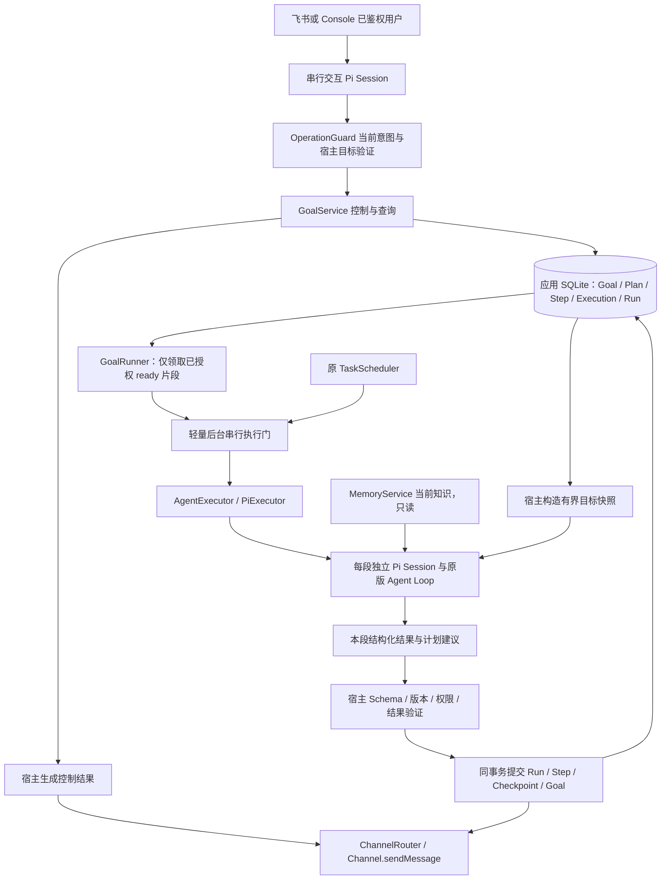
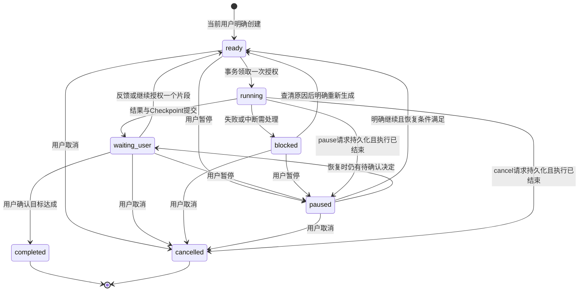
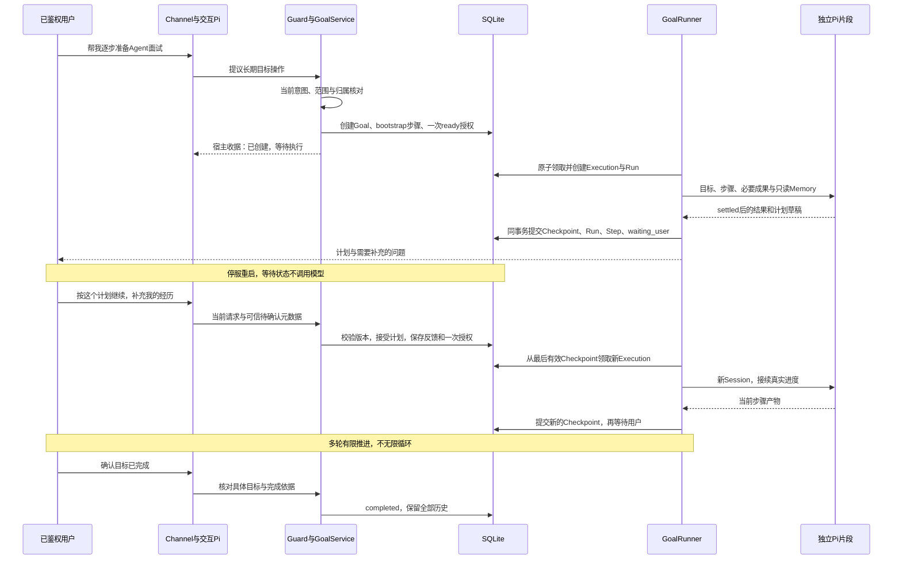

# V3.0：持久化长期目标与有界执行

状态：**V3.0 Batch 1–4 已发布74704bd；Batch 5电脑核心验收通过，48请求已用尽，完整清单未全通过**。日期：2026-10-23（Asia/Shanghai）。已补默认关闭的GOAL_ENABLED与回归，按用户调整在电脑进行隔离真实模型验收；保留原四表模型、Task/Memory语义和权限边界。

核对基线：本轮开始时本地HEAD、origin/main及实际远端main均为 `51bc736366733060e91625c881248dce268ceb9c`；Batch1未提交改动及原有HANDOFF.md保留。仅对虚构临时数据库与模拟模型验证；没有收费调用、正式服务/数据操作或Git推送。第1节基线及第15节Batch1记录是历史快照，当前新增实现见第16节。

## 1. 结论与设计依据

建议采用：**SQLite 持久 Goal + 版本化 Plan + 稳定 Step + 多次短生命周期 Pi 执行**。Goal 是持续责任，Step 是计划中的工作单元，Execution 是一次有界尝试，Checkpoint 是已提交的成果及继续依据。聊天 Session 负责交流，Memory 提供知识，二者均不能成为目标进度的事实源。

V3.0 每个明确的创建/继续请求最多启动一个执行片段，之后等待用户；不做无人值守的连续自主循环。初始片段可以分析已知条件、提出计划和能力诊断问题；没有简历或反馈时不得虚构分析依据。计划不写死为面试专用流程。

### 1.1 现有代码核对

下列位置描述 `51bc736` 的设计前快照；本轮新增的存储实现见第15节，Runner/渠道等尚未实施部分仍是设计。

| 当前事实与位置 | 对 V3 的约束 |
| --- | --- |
| [contracts.ts](../../src/contracts.ts) 的 `ExecutionRequest.scope` 只有 `chat / task`；执行返回 `{ text }`；Run 只有 `running/succeeded/failed/interrupted` | Goal 需要新增执行用途和业务结果校验，不能将模型文本直接当状态 |
| [sqlite-store.ts](../../src/sqlite-store.ts):16–38，`runs.taskId TEXT UNIQUE REFERENCES tasks(id)`，允许多个 NULL | 同一旧 Task 不能反复创建 Run；新 Goal Execution 可用 `taskId=NULL` 的独立 Run，但必须另有持久关联 |
| `claimDue()` 在 `BEGIN IMMEDIATE` 内条件领取并创建 Run；`finishRun()` 同事务结束 Run 和对应 Task | 保留这套一次性约束；Goal 另建领取/提交聚合事务，不能把旧 Task 改回 pending |
| `recoverInterrupted()` 将**所有**遗留 running Run 标记 interrupted，Task running 同步中断 | 新 Goal Run 同样会被覆盖；恢复时必须同步处理 Goal Execution，不能只改其中一边 |
| [scheduler.ts](../../src/scheduler.ts) 有单实例 busy、Memory 预检、串行到期任务、结果先提交后通知 | busy 不覆盖第二个 Runner；不能假设新增 Goal 后后台仍天然串行；通知缺口仍存在 |
| [pi-executor.ts](../../src/pi-executor.ts):26–91 检查 `agent_settled`、stopReason、abort、工具及审计错误 | 沿用生命周期验证；`agent_end`、`agent_settled` 都不直接代表 Goal/Step 完成 |
| 同文件 `execute()` 复用 chat Session，task 每次创建并 dispose；createAgentSession 用公开 API，后台无工具 | Goal 每个片段同样用独立内存 Session，不能复用交互 Session 或无限延长一个 Session |
| [operation-guard.ts](../../src/operation-guard.ts) 只为当前 chat 绑定一次操作；隔离解析、原文证据、固定编号、5分钟引用与版本验证 | 可增量接入 Goal 控制，不把历史/Memory 变成授权；现有 Task/Memory 行为必须回归不变 |
| [memory-service.ts](../../src/memory-service.ts) 的请求上下文、只读检索和 `buildContext()`；Markdown 与应用库无共同事务 | Memory 继续只提供当前知识，不能保存 Goal Checkpoint 或参与目标状态原子提交 |
| [feishu-channel.ts](../../src/feishu-channel.ts) 鉴权后持久去重，前台按队列串行；`finishRun()` 后才 sendMessage | Goal 执行不能阻塞整个前台队列；控制消息仍需等前面的聊天处理完，不能承诺即时取消 |
| [main.ts](../../src/main.ts) 获得独占锁后恢复，再启动 Scheduler/Formation；退出先停止执行再关闭存储 | 新 Runner 同样独立于终端；恢复全部完成后才能领取，退出要等执行和日志停止 |
| [formation-service.ts](../../src/formation-service.ts) 的 enqueue 当前排除 Memory 操作，`taskId=NULL` 本身不能证明是普通聊天 | Goal Run 不调用 enqueue；Goal 控制聊天也按新操作收据排除，不能把计划/进度自动提炼成事实 |

该基线没有 Goal 表、计划修订、Checkpoint 提交接口、通用待确认操作表或可靠通知 Outbox。本轮只补上 Goal 存储能力，不把其余建议写成现有能力。

### 1.2 三种路线比较

| 路线 | 上下文与成本 | 恢复、动态计划与实现代价 | 判断 |
| --- | --- | --- | --- |
| A：一个长期存活的 Pi Session/Loop | 连续交流方便；历史逐渐增长，跨数天等待占用进程资源，长上下文成本不可控 | Session 无法表达业务提交点、审批和外部结果不确定；重启仍须补业务状态机 | 不采用；可以保留聊天历史，但不能承担执行调度 |
| B：每一步创建一个旧的一次性 Task | 复用 TaskScheduler；每个 Task 仍只有一条 Run | 不破坏旧唯一约束，但需要另建目标/计划/等待状态；dueAt 不能自然表达用户等待，跨计划取消与提交变得分散 | 可用于以后为 Goal 安排一个提醒；不作为 Goal 核心 |
| C：Goal 状态 + 多次独立 Pi 执行 | 每段只加载必要成果和 Memory；每次重新组装有固定开销，但可限制大小与次数 | 领取、Checkpoint、等待和版本明确；需要新增小型状态存储/Runner/授权适配 | **推荐**；复用 Pi 推理能力，不实现另一套 Agent Loop |

无需 Temporal、LangGraph、Redis 或微服务。当前没有跨机器调度、高并发或大量外部动作，SQLite 短事务和单进程执行足够。后续规模变化再用实际瓶颈评估。

## 2. 总体架构与模块边界



- **GoalService**：目标归属、创建/查询/暂停/继续/取消/确认/调整计划、状态不变量。只依赖业务接口和存储，不接触 Pi 类型。
- **GoalRunner**：独立 start/stop/tick，领取一个 ready 片段，调用 Executor，验证并提交结果、发送通知。V3.0 不再单独创建 GoalScheduler 类；Runner 内的轻量扫描就是调度，尚不处理时间/外部事件。
- **GoalStore**：可类似 FormationStore 作为 SqliteStore 的子模块，共用**同一应用库连接**。不复制 Memory 索引或新建跨库事务。
- **AgentExecutor**：增加显式 `goal` 用途及宿主快照/检索查询入口；仍返回文本，由 GoalRunner 解析提议。Pi 类型仅留在适配层，不把 Session 传给服务。
- **TaskScheduler**：继续只处理旧 Task。两个后台入口共享一个轻量进程内执行门，防止 Task 和 Goal 同时占用后台执行；门不是持久队列，崩溃恢复依靠 SQLite。
- **Channel**：只负责投递，目标接收人由可信入口持久化。可以增量增加可选 goalId 便于审计；发送仍必须关联有效 Run，模型不能选择目标。

后台门在领取前获取、结束后 finally 释放，不在等待门或请求模型时持有数据库事务。到期旧 Task 优先，Goal 在没有前台排队工作时领取；不抢占已经运行的旧 Task。已经开始的 Goal 片段也不透明重跑来让位，因此此时新到期的 Task 可能等待至该片段结束或超时；这是共享后台串行模型的延迟取舍，不保证提醒准点。长期忙碌可能延迟 Goal，需要显示排队状态，不能称实时调度。交互请求仍能与独立 Goal 运行并行，用于登记暂停/取消。

## 3. 持久化概念：四张新表足够

| 概念 | 持久化方式 | 不是它的职责 |
| --- | --- | --- |
| Goal | `goals`：当前目标、归属、状态、当前版本/步骤/Checkpoint 指针、当前待处理输入与决定 | 不是 Session、不是知识库，也不是重复执行的旧 Task |
| Plan | `goal_plans`：不可变版本快照，含有序步骤定义、验收依据、适用目标 Hash 与变更理由 | 不是固定工作流或无限 DAG |
| Step | `goal_steps`：稳定 ID 与执行状态；定义从对应 Plan 快照读取 | 不是一次模型请求；同一步可以等待反馈并有多次 Execution |
| Execution / Attempt | `goal_executions`：每个有界片段关联一个独立 Run，保存输入快照、版本、结果提交状态 | 不另建一套 Run/Events/ModelCalls；Execution 与 Attempt 同义 |
| Checkpoint | 已成功提交 Execution 的不可变 `checkpointJson`，Goal 只保存最后一个有效指针 | 不保存模型隐藏推理、SDK 内部状态或整份聊天历史；无需第5张表 |
| Wakeup / Trigger | V3.0 用 Goal 的 ready 状态和已验证用户输入表示“可执行一次” | 不建通用触发器表，不把等待用户换成轮询模型 |

多天计划只是数据库记录长期保留，不意味着 Pi 必须连续运行几天。完成步骤数、尝试次数、耗时可由 Step、Execution 与 Run 推导，不再维护第二套统计计数器。

### 3.1 字段与约束

所有新表使用 STRICT、CHECK、外键，时间为规范 UTC ISO 字符串。下述是数据字典；Batch 1 的实际 DDL 见 `src/goal-store.ts`，只在打开应用库时增量创建新表，不改旧表。

| 表 | 建议字段与关键规则 |
| --- | --- |
| `goals` | `id` PK；`ownerId` 宿主本地稳定单用户标识；`accessKey` 可信渠道绑定 Hash；`targetJson` 原 MessageTarget；`objective` 原始目标；`createdByRunId` UNIQUE FK runs；`status`；`revision` 整数 CAS 版本；`planRevision`；`currentStepId` 可空；`checkpointRunId` 可空；`readyInputJson` 可空；`pendingActionJson` 可空；`controlRequested` 只允许 NULL/pause/cancel；`blockedReason` 可空；`createdAt/updatedAt/finishedAt` |
| `goal_plans` | `(goalId, revision)` 联合 PK；`baseRevision`；`sourceRunId` FK runs；`approvedByRunId` 可空 FK runs；`specJson`（有序 Step 定义、完成条件、目标 Hash）；`changeReason`；`hash`；`createdAt`。只 INSERT，已接受版本不原地改写 |
| `goal_steps` | `id` PK；`goalId` FK goals；`status`；`lastExecutionRunId` 可空 FK runs；`createdAt/updatedAt`。Step 文字、顺序和验收条件由 Plan 指定，避免两份可变定义 |
| `goal_executions` | `runId` PK/FK runs；`goalId`；`stepId`；`planRevision`；`sequence`；`triggerRunId` UNIQUE FK runs（授权这一次执行的用户 Run）；`baseGoalRevision`；`baseCheckpointRunId` 可空；`capabilityClass='text_only'`；`status`；`inputJson`；`inputHash`；`checkpointJson` 可空；`checkpointHash` 可空；`reasonCode` 可空。时间/输出/错误/投递状态复用 Run |

Plan 中每项形如 `{ stepId, title, instruction, deliverable, doneWhen }`。V3.0 顺序执行，无依赖图；全部 Step 必须属于同一 Goal，ID 由宿主创建或从当前合法步骤中保留，模型不能指定其他 Goal 的步骤。

建议初始最多12个当前步骤、标题/说明/产物分别限长。旧 Plan 和已提交成果不可变；变更时保留已完成且定义未变的 Step ID，改变已完成工作的含义必须新建 Step，并引用旧成果，不能篡改历史。被新计划移除且未完成的 Step 标记 superseded，不物理删除。当前进度仅按当前 Plan 引用的步骤计算，旧计划和 bootstrap 的成果另列，不用全表完成数制造错误百分比。

必须落实的数据库约束：

```sql
-- 仅展示新表的关键索引，不是迁移脚本。
CREATE UNIQUE INDEX goal_one_running
  ON goal_executions(goalId) WHERE status = 'running';
CREATE UNIQUE INDEX step_one_running
  ON goal_executions(stepId) WHERE status = 'running';
CREATE UNIQUE INDEX goal_execution_sequence
  ON goal_executions(goalId, sequence);
CREATE INDEX goal_ready_queue ON goals(status, updatedAt, id);
```

另对 `(goalId, stepId)`、`(goalId, planRevision)`建立所属关系约束；`checkpointRunId` 必须指向同一 Goal 中 status=committed 的 Execution。可用的外键负责存在性，所属关系、指针和 JSON Schema 由同一聚合事务再次验证。`readyInputJson` 只在 ready 存在，领取后转入 Execution 输入；running 必有且只有一个 running Execution；终态没有 ready 输入或待执行控制。任何一项不一致均阻塞并保留现场。

`runs.taskId` 原 UNIQUE 和旧状态 CHECK 不动；新 Goal Execution 的 Run 固定 `taskId=NULL`。普通聊天也可能 NULL，因此分析/恢复/形成过滤时用 `goal_executions.runId` 显式关联，不能用 NULL 猜 Run 用途。Goal 控制的前台聊天 Run 与后台执行 Run 是两条不同记录，用 triggerRunId 关联。

### 3.2 事务边界与实现影响

建议将 `SqliteStore` 中已有的 Run 写入拆出**私有、同连接、无自行 BEGIN 的内部小方法**，保留原 `beginRun/finishRun/recoverInterrupted` 公共行为；Goal 聚合方法在一层事务里调用。不要直接从 GoalStore 嵌套调用当前会自行 BEGIN 的 `finishRun()`，也不能把 Formation 的 SAVEPOINT 式“可失败队列”套给 Checkpoint。

- **创建事务**：原文目标、归属、Plan v0 的宿主初始化步骤“梳理目标与初步计划”、pending Step、一次 ready 输入、控制事件一起落盘。createdByRunId 防止同一请求重复创建。不是完整面试模板。
- **领取事务**：检查 owner/binding、ready、无 controlRequested、对应用户授权尚未消费、当前版本与可用步骤；条件 UPDATE 为 running，创建 `beginRun(NULL)`、Execution 输入快照和领取事件，一起提交。triggerRunId UNIQUE 防止同一授权启动两次。
- **结果事务**：同步进入事务前检查本片段/全局 AbortSignal，再比较 Goal revision、Plan revision、Step、先前 Checkpoint 指针、Execution=running、无暂停/取消；结束 Run、提交 Execution Checkpoint、更新 Step、更新 Goal 指针/状态及事件，一起提交。Checkpoint 失败必须回滚整个聚合提交，不允许 Run 成功而进度未提交。
- **控制事务**：查询当前状态后以 revision CAS 更新；暂停/取消先持久化再 abort；确认消费准确的草稿 Hash 和版本；计划修订与 Step 更新同事务。任何数据库 await/网络请求均在事务外。

如果 COMMIT 返回错误或进程在提交响应前断开，先按 runId 重读同库：已完整 committed 则采用；完整未提交则按失败策略；无法重读就停止新 Goal 领取，退出并在重启后核对。不能因异常直接调用旧 finishRun 再标失败，更不能再次调用模型“补交”。SQLite/WAL 的原子性不等于硬件断电、损坏或外部操作恰好一次。

前台控制的事务成功与前台聊天 Run 最终成功仍是两个时点，类似现有 Task 工具写入。控制已提交后主模型失败/发送失败，不撤销 Goal，也不能以该聊天 Run 后来 interrupted 推断控制未发生；恢复只承认同事务的控制收据及真实 Goal 状态。未提交的模型提议则不产生 ready 权限。这一窗口需要专门回归。

### 3.3 Bootstrap、计划批准及步骤切换的精确事务

1. `create` 同一事务 INSERT Goal、宿主生成的 bootstrap Step、已接受 Plan v0、创建收据和一次 ready 授权。v0 是初始化工作说明，不是用户已批准的完整业务计划。未领取授权在重启后保留；领取把授权从 Goal 移入 Execution，之后不能再用同一来源 Run 获得第二次执行。
2. bootstrap 的 `complete` 必须同时给出候选计划。结果提交把 bootstrap 标 completed，Checkpoint 指向本次 Execution，Goal 进入 waiting_user；**Plan v1 此时仅是 `pendingAction` 草稿，不插入 `goal_plans`、不创建业务 Step**。草稿正文和 Hash 同时保存进 Checkpoint，当前接受版本仍为 v0。`partial` 可继续询问目标条件；`blocked` 保存阻塞原因。
3. `approvePlan` 核对 Goal revision、草稿 Hash、baseRevision 和当前待审批内容；同一事务创建新 Step、INSERT 下一不可变 Plan、标记被移除的未完成 Step 为 superseded、切换 planRevision/currentStepId、清空 pendingAction、记录批准收据。只批准则 waiting_user，不执行；只有宿主已验证的批准请求明确包含“继续一段”时才同时写入一次 ready 授权。
4. 保留的 Step ID 必须属于本 Goal、定义逐字段不变。改变定义使用新 ID；已完成步骤只能保留原义。新计划中已完成步骤必须在未完成步骤之前；当前 Step 为新计划第一个未完成项，全部完成则为空并等待用户最终确认。步骤数上限12。不支持并行/DAG。
5. 旧 Plan、Execution、Checkpoint 不 UPDATE；批准新计划不改旧成果。`complete` 提交时切到当前 Plan 下一个未完成 Step，但它仍 pending，Goal 仍 waiting_user，不能自动领取。计划草稿存在时，“继续”不能绕过审批。

### 3.4 数据库收据与重展示

每个创建/继续/审批/暂停/取消/完成命令在同一事务写 `run_events.type=goal_control` 收据，含来源 Run、Goal ID、动作、提交 revision。一个来源 Run 最多一个 Goal 控制；重复请求只能读取收据，不能再次授权。源聊天 Run 后来 failed/interrupted、聊天发送失败均不撤销已提交控制。

只读 `view(actor, goalId)` 返回当前 Goal、当前 Plan/Step、最后已提交 Checkpoint、各 Execution 与对应 Run（包括 deliveryError）；`controlReceipt(actor, sourceRunId)` 根据收据重新定位状态。结果通知丢失时使用 Checkpoint 的 artifactText 及 runId/version 再展示，不能调用 continue/claim 或重新生成。没有 deliveryError 不代表已送达：发送后崩溃仍可能未记日志，本批不提供可靠投递保证。批准后的草稿可从原 Checkpoint 查阅，当前 pendingAction 清空不等于抹去已显示的方案。

## 4. 状态机与完成语义

### 4.1 Goal 状态



running + controlRequested 表示“暂停/取消正在停止中”，不能提前回复“已停止”。paused 保留 Step 与 Checkpoint；继续前仍检查 blockedReason 和 pendingAction。若仍需批准计划/确认完成，恢复为 waiting_user 并重新展示，不能用“继续”绕过决定。取消是终止未来推进，不删除成果，也不撤销已发生的动作；completed/cancelled 不直接重置，新需求创建新 Goal 并可引用旧成果。

### 4.2 Step 与 Execution 状态

| 对象 | 状态与意义 |
| --- | --- |
| Step | `pending` 未开始；`running` 有当前片段；`waiting_user` 有部分成果但需反馈；`completed` 本步骤产物已提交；`failed` 明确执行失败；`blocked` 结果/条件待处理；`superseded` 被新计划替换 |
| Execution | `running` 尝试中；`committed` 结果进入有效 Checkpoint；`failed` 没有通过业务校验的结果；`interrupted` 执行被中止/进程退出；`discarded` 结果到达但版本/控制已变化，不能更新进度；`uncertain` 无法确认结果或外部效果 |

Run 的技术状态与 Execution 的业务状态分开：正常 Pi 结束且 Schema/版本/业务校验通过，才 Run=succeeded、Execution=committed；无效输出为 failed；中断为 interrupted。迟到但技术执行正常的文本可保留为 succeeded Run + discarded Execution，**不**产生有效 Checkpoint。现有 Run 无 discarded/uncertain 枚举，不能擅自添加；中断且效果不确定时 Run=interrupted、Execution=uncertain。

一次 Execution 可以完成一个 Step，也可以留下部分结果让同一步等待用户。同一步收到反馈后产生新 Execution，而不是修改上一次的结果。completed Step 仅代表已交付且符合宿主可验证格式的产物，不证明用户已经学习、掌握能力或获得面试。主观目标完成必须展示依据并由用户确认；模型最多建议完成。

有效结果在同一事务结束 Run=succeeded，并按下表提交；三种结果都保存不可变 Checkpoint 并更新 Goal 指针。这里的 blocked 是“有可保存的结果但无法推进”，不同于模型失败时无新 Checkpoint。

| stepOutcome | Execution | 当前 Step | Goal 与下一步 |
| --- | --- | --- | --- |
| partial | committed | waiting_user | waiting_user，currentStepId 保持，下一次明确继续才开启新 Execution |
| complete | committed | completed | waiting_user，currentStepId 切到下一个未完成 Step；最后一步后为空，必须用户另行确认 Goal 完成 |
| blocked | committed | blocked | blocked，currentStepId 保持，必须提供原因；只有明确解决原因并重新生成的授权才可再执行纯文本 |

正常模型失败：Execution=failed、Step=failed、Goal=blocked、Run=failed；中断：Execution=interrupted、Step=blocked、Goal=blocked、Run=interrupted。二者都不移动 Checkpoint。`uncertain` 不提供继续入口；本批只为不变量破坏保守保留此状态，不声称支持外部副作用核对。

等待类别：V3.0 仅真正实现 `waiting_user`（反馈、计划确认、完成确认）；`waiting_time / waiting_event` 为后续设计概念，不加入可领取状态或假装支持。用户要求“下周自动继续”时说明当前只能手动继续，现有一次性提醒可独立使用，但不会隐式唤醒 Goal。

## 5. Pi 一次执行、Checkpoint 与动态规划

### 5.1 调用形式

新增 `scope='goal'`，每次创建 `SessionManager.inMemory()`，沿用公开 createAgentSession、resourceLoader、context Hook、abort、subscribe 和 dispose。仓库安装的 Pi 1.3.0 `docs/sdk.md` 已核对 Session 生命周期、工具配置与 agent_settled；不依赖内部消息数组或未声明的原生工作流恢复能力。

Goal Session 的工具白名单固定为空。MVP 的任务是分析、计划、出题和整理反馈，最终结构化文本足够；不需要模型自己调用“提交 Checkpoint”工具，更不能给它 Goal 状态写权限。业务提交由 Runner 在 Pi settled 后完成。聊天 Session 增量增加一个受控 `goal_manage` 适配工具，参数只作提议或无参数，真正操作由 Guard 从当前原话和 SQLite 核对。

Executor 的既有 `{ text }` 返回可以保留，GoalRunner 对 `text` 执行严格 JSON Schema 校验；不另调用一个 Planner 模型。未来类型可增量加 goal 请求字段，但不能让业务模块依赖 Pi 类型，也不能将 goal 伪装成 chat 获得 Task/Memory 工具。

一次正常片段建议只有一次主模型请求；禁止 SDK/HTTP 自动重试、工具循环与自动继续。保留执行超时并设输出上限；解析失败先 blocked，不静默再调用模型修 JSON。当前执行生命周期验证仍是必要前提。

### 5.2 宿主输入快照与容量

建议初始容量：Goal 输入上下文总预算16 KiB UTF-8，其中当前目标/本次原话至多4 KiB、当前计划/步骤至多4 KiB、Checkpoint 摘要与必要成果至多6 KiB、Memory 至多2 KiB；固定系统指令与输出另计。超限不悄悄截掉用户否定、范围或目标；宿主要求缩小/分段，或只加载明确成果引用。不把 bytes 冒充精确 Token 数。

Batch2现已构造独立有界投影：目标与授权合计4 KiB、计划与当前Step4 KiB、前一Checkpoint6 KiB，快照合计14 KiB，Memory最多2 KiB，固定Schema/系统说明与输出另计。完整目标/反馈、计划、摘要和问题超限阻塞且不调用模型；长artifactText只加载明确标记的摘录和原runId引用，数据库正文不变。尚无任意历史附件加载或无限上下文。

快照包含：Goal/Plan/Step ID与版本、前一 Checkpoint、目标原文、本次经验证反馈的 source Run、当前步骤定义、必要已提交成果、计划内验收条件、允许能力和用户问题。宿主提供 ID/版本/能力；模型输出不得覆盖这些值。Checkpoint/Memory 中的文字都按低信任资料处理，旧用户原话只解释目标，不构成本次新权限。

Memory 检索使用宿主从目标和当前步骤形成的有界查询，独立于整个 JSON 快照；保留当前 context Hook 和预算，读取当前有效版本、记录命中 ID/kind/version。查询改写仍默认关闭，不为 Goal 自动开启。Memory 损坏按既有预检阻止领取；领取后损坏则执行失败，不改成无校验降级回答。

### 5.3 模型提议与宿主结果

Batch 1 的结果契约使用 `artifactText`、`progressSummary`、`stepOutcome`（partial/complete/blocked）、`question`、可选 `blockedReason` 和 `proposedPlan`。后续 Runner 校验同名模型提议，不允许模型提供权限、接收人、外部工具、绝对唤醒时间或直接终态命令；目标完成建议仅作为等待用户确认的问题，不等于完成。

宿主核对格式、长度、所需产物、当前版本、归属和允许能力，再构造 Checkpoint：

```text
checkpointJson = {
  schemaVersion,
  goalId, planRevision, stepId, executionRunId,
  previousCheckpointRunId,
  inputSourceRunId, stepOutcome,
  artifactText, progressSummary, question,
  blockedReason, proposedPlan
}
```

除产物/摘要等低信任内容外，标识、前指针、计划草稿 Hash 和下一位置由宿主填写。Checkpoint 只在结果事务成功后有效，不能使用未提交的 run_events/Session 文本补进度。较早成果保留在原 Run/Checkpoint，摘要不是唯一历史；下一次只加载当前必需项。Memory 命中审计复用原事件，尚未在本批增加 Checkpoint 的 Memory 引用列表或通用产物附件。

语义正确性不能仅靠 Schema 证明：模型可能误判“能力已掌握”或写错计划。MVP 对文本交付做结构验证，把真实学习效果交给用户反馈；对事实不足明确提问，对目标达成与计划实质变更要求确认。不能将模型“已完成”的句子当作真实外部执行证据。

### 5.4 动态调整计划与目标变化

初始 bootstrap 片段形成 Plan v1 草稿，先保存 Checkpoint 和 pendingAction，向用户显示后等待；Plan v0 仍是当前已接受版本。用户同意“按这份计划执行下一段”，宿主才同事务新增 v1、同步 Step、消费待确认并授予一次 ready 输入。

后续模型可按进度建议重排/拆分未完成步骤，但不能静默改掉完成条件或忽略用户范围。V3.0 采用保守边界：**实质 Plan 修订都展示差异并确认**；选择既定计划中的下一未完成步骤不算重规划。待确认草稿在 goals.pendingActionJson，不把未批准 Plan 当当前可执行计划。

用户说“先补 Agent Loop”“改成准备后端岗位”时，先绑定唯一 Goal、记录新请求，取消尚未领取的旧 ready 输入；如果正在运行，先登记 pause，再在旧片段结束后展示新目标/计划。已完成成果保留；目标和验收标准改变须确认，提升 revision、产生新 Plan，旧确认与继续授权失效。模型建议范围无法可靠验证时保守询问，不靠大量正则证明语义等价。

## 6. 一次长期目标的完整执行链路



创建确认可能先于首段完成；“已创建/已排队”与“本段已完成”必须使用不同宿主收据。GoalRunner 不把工作直接塞进前台 Session；消息发送失败也不回到执行入口。

## 7. 自然语言入口与授权

### 7.1 普通对话、Task 和 Goal 的识别

- “这个知识点是什么”默认聊天；“两分钟后提醒喝水”保留原 Task；“持续准备面试、分阶段跟我做”可提议 Goal。没有可靠意图时问“你要一份建议，还是保存成可以继续推进的长期目标？”
- 主 Agent 做语义理解和工具提议，写前仍由同一 OperationGuard 获取当前原话的隔离意图。只增量添加 Goal 操作分支，不重写现有 Task/Memory 分支；错误工具类型不能执行另一类操作。
- 明确的低风险 Goal 创建可保存原始目标并授权一个 text_only bootstrap；模型重写目标、增加范围、安排无人值守推进则先展示确认。不会因为用户创建一个 Goal，就获得无限模型调用或未来外部执行授权。
- 不每轮额外做一个路由模型。只在需要 Goal 变更时复用一次隔离解析，输入仍限当前用户消息和可信待选类型/数量/确认标志，不发送 Memory、旧聊天、Goal 产物或模型建议正文作为授权依据。查询不自动变更状态。漏工具风险仍存在，必须用端到端测试量化；本阶段不新增通用纠错 Agent。

### 7.2 身份、目标与指代

ownerId 是宿主本地单用户标识，不把飞书 open_id 当永久个人 ID。accessKey 由可信 MessageTarget（渠道/应用/用户/会话）规范化生成，模型不能提供；Console 与飞书暂不自动互认控制范围，更换渠道绑定不能自动接管旧目标。

宿主从该 owner 与绑定的 SQLite 真记录筛选目标，模型候选仅供参考。名称/项目/状态条件与“刚才”“最新”等指代取交集，不可互相覆盖；唯一明确目标才执行。多个目标显示固定编号，“继续我之前那个面试任务”如果匹配两个就询问，不按相似度擅选。

沿用当前序号独立验证、归属检查、有限引用与一轮一次消费机制。新 Goal 操作必须消耗同一个 Frame 的权限，不能另起一套可与 Task/Memory 并发消费的授权上下文。编号引用可继续使用 Pi custom entry 的**元数据**，但每次回查 SQLite；全新 Session 无引用时重建清单，不依赖聊天历史才能找到 Goal。

持久等待问题、未批准计划/目标变更/完成决定在 SQLite，绑定 Goal revision、计划版本、草稿 Hash、来源 Run；其存在可以跨数天，但短句“确认”需要当前已成功展示的、未过期的视图（建议仍5分钟）。重启后视图过期或新 Session 时重新展示即可，不能丢草稿或自动批准。展示投递不确定时不能声称用户已经看到。

用户普通学习反馈只有在唯一 waiting_user 问题/有效视图可绑定时，才成为该 Goal 的新输入；“我今天学完了”若可能对应多目标就澄清。记下本次反馈可供恢复，不等于把反馈自动保存为长期 Memory。

### 7.3 暂停、继续、取消与确认

| 用户意图 | 宿主行为 |
| --- | --- |
| 看进度 | 读 Goal/当前 Plan/Step/Checkpoint 与 Run，固定展示已交付、当前等待、错误和投递状态；不调用后台模型 |
| 暂停未运行的 Goal | 条件更新 paused，撤销未领取的 ready 输入，保留成果；重复暂停返回当前状态 |
| 暂停/取消正在运行的 Goal | 同事务写 controlRequested 并提升 revision，禁止新领取和原结果提交；再按 executionRunId 的 AbortController 中止。结束后记 interrupted/discarded、将 Step 从 running 移出，Goal 才转 paused/cancelled |
| 继续 | 重新验证身份、唯一目标、当前版本和恢复条件；一条当前请求最多预留一个片段。running 时不再排第二次；completed/cancelled 不恢复 |
| 反馈/确认计划 | 保存当前原话及来源 Run；核对草稿/显示/版本，确认范围仅限展示的动作。是否同时执行下一段必须在待确认内容中明确，不能由一句“确认”偷偷扩大 |
| 完成 | 模型只能建议；用户明确确认指定目标已经达成，宿主才完成并保留验收说明。仅waiting_user可完成，running时先停止再确认；“不用做了”应取消，不能当达成，不能假装全部学习活动已经发生 |

取消和结果提交竞争时，以同库条件事务的提交顺序为准：结果先提交，则取消后续推进并保留该成果；控制先提交，则迟到结果不能成为进度。进程内 abort 只是加速停止，**持久 revision 检查才是禁止迟到提交的依据**。SDK/供应商不响应 abort 时保持“停止中”，不得启动替代片段来绕开它。

## 8. Checkpoint、故障与恢复矩阵

| 故障点/情况 | 可确认状态与恢复动作 | 禁止行为 |
| --- | --- | --- |
| 创建后、领取前退出 | ready + 一次未消费授权持久化；重启核对绑定、版本和健康条件后允许领取 | 不因重启再创建 Goal 或额外授权 |
| 步骤结果和 Checkpoint 已提交后退出 | committed + 指针/Step/Goal 一致；从新等待点继续 | 不重跑已完成步骤，不用通知缺失推断执行没成功 |
| 模型已有文本、结果事务尚未提交 | 文本不是有效进度；运行中的 Execution 在恢复时中断并 blocked | 不从 Session 或日志拼接“已提交”，不盲重跑 |
| COMMIT 是否成功不明确/数据库不可读 | 停止新 Goal 领取；重读完整事务状态或重启核对；保存可用的错误摘要 | 不先标成功再补状态，不把日志缺失当无副作用 |
| 模型错误、无settled、截断、非法JSON、Memory/审计故障 | failed/interrupted Execution，Step failed/blocked，Goal blocked；上个有效 Checkpoint 不变 | 不立即自动重试，不静默再次收费修复JSON |
| 运行中进程被强杀 | 原 Run interrupted；关联 Execution interrupted、Step blocked、Goal blocked；保留输入与上个 Checkpoint | 不把 running 自动放回 ready |
| 用户未批准草稿时重启 | pendingAction 与 waiting_user 保留；重新显示并核验当前版本后才批准 | 不用历史“好的”或模型 confirmation 标签直接批准 |
| 用户等待数天 | 不运行模型、不反复消耗 Token；保持最后问题和成果 | 不靠常驻 Session 或 Project Memory 保存进度 |
| 暂停/取消时结果迟到 | revision/controlRequested 使提交失效；记录 discarded 或 interrupted，执行终止后完成控制 | 不推进新 Step，不宣称已回滚旧外部动作 |
| 任务结果已提交、发送失败/崩溃 | 状态不回滚；可记录时写 deliveryError；用户查询可重现成果/待办问题 | 不因消息未收到重跑 Goal 或原 Task |
| 工具超时、外部效果不确定（未来能力） | Execution uncertain、Goal blocked，记录操作关联和核对需求；须有外部幂等键/查询证据才决定重试 | 普通“继续”不能授权重做未知副作用，不保证 exactly-once |

V3.0 无外部动作工具，允许用户了解中断后明确要求**重新生成**纯文本片段；这是一个新 Execution，可能再次计费，不是透明重试。原失败/中断的 Execution 不改回 running，仅把合法的当前 Step 重新置为 pending，并以新授权建立尝试。若以后支持副作用，必须另行实现效果账本/核对与对应审批；当前 uncertain 状态只作为保守阻塞，不提供“强行再执行”入口。

启动顺序建议：获得原数据库/Memory 锁 → 构造存储和只读执行条件 → **协调恢复旧 Run/Task 与新增 Goal Execution** → 校验指针/计划/Step/待决定 → 连接正确渠道 → 启动 TaskScheduler 和 GoalRunner。恢复实现用同连接内部方法，避免新旧恢复各自 BEGIN；即使调用旧公开 recoverInterrupted，也必须在任何领取启动前完成幂等 Goal 对账并验证，不能让它先把 Goal Run 中断后仍按 running 领取。

恢复时只处理 Execution=running 或不一致记录，不改变已 committed 的成果。若观察到“Run成功但Checkpoint未提交”这类按设计不应出现的组合，保守 blocked，报告违反不变量；不能按 Run 文本猜测业务成功。检查幂等，第二次恢复不产生新的执行或重复终态事件。

### 8.1 已持久化控制优先级

在同一个恢复事务中，先以持久化控制决定最终落点，再清理遗留 running Execution；不会先无条件把 Goal 改 blocked 而丢掉控制：

| 崩溃前状态 | 恢复后 Goal | Execution / Step | 后续规则 |
| --- | --- | --- | --- |
| running + cancel | cancelled | interrupted / blocked | 清空控制、ready、待审批；永不继续，旧 Checkpoint 保留 |
| running + pause | paused | interrupted / blocked | 清空控制和 ready，保留待审批及中断原因；普通继续不能掩盖中断，须明确重新生成或先处理待审批 |
| running + 无控制 | blocked | interrupted / blocked | 无 ready，不自动重试 |
| Run 已终止但 Execution 仍 running | cancel/paused 仍优先；否则 blocked | uncertain / blocked | 保留不一致原因，禁止重新执行；不凭 Run.output 补 Checkpoint |

cancel 可以覆盖停止中的 pause，pause 不能覆盖 cancel。控制先提交而结果后到：结果 Run 可 succeeded、Execution=discarded，Step blocked，Goal 按 cancel/paused 落点，Checkpoint 不变。结果先提交而控制后到：保留新 Checkpoint，再暂停/取消未来推进。所有这些更新与对应事件同事务；第二次恢复不新增终态事件。恢复只可在取得进程独占锁、没有活跃 Runner 时调用。

主进程退出先停止新领取、登记/中止活跃片段，等待 Runner、前台和投递停止，再关闭 Executor/存储并释放锁。Goal 级取消与全进程 shutdown 使用不同 controller，不能为了取消一个 Goal 停掉所有旧 Task。

## 9. 幂等与实际保证

- 同一飞书 message_id 仍由原 feishu_messages 去重。控制以当前 Run 为来源，重复的工具提议消费同一 Frame；创建有 createdByRunId UNIQUE，片段有 triggerRunId UNIQUE。
- 单 Goal/Step 同时至多一个 running Execution；短事务条件更新、部分唯一索引、独占进程锁和后台门分别防领取竞争、重复活跃与进程内并行。没有分布式租约/自动抢占，不能迁移为多进程后沿用此保证。
- Checkpoint、Step、Goal 与本段 Run 的最终状态是一个应用 SQLite 事务；一次授权至多提交一次有效进度。正常提交后重复 finish 被拒绝，不重复增加步骤或计划。
- 这些保证**不**涵盖模型请求只计费一次、飞书只送达一次、操作系统强制终止时的外部效果。已发出的模型请求可能计费但没有用量记录；发送超时可能已经收到。
- 本次不开发 Outbox，不能保证主动通知可靠送达。Goal 状态可查询、结果可再展示，不等于通知已可靠。重要提醒/无人值守推进开始前应另行审查可靠投递，不能借 V3 状态持久化掩盖原通知窗口。

## 10. Memory、Session 与安全边界

1. Task 保持原一次性表与唯一 Run；Goal 表管理进度；Pi 交互 JSONL 保存交流；Memory Markdown 保存批准的知识，各自独立。备份 Goal 直接随应用库，不把 Memory 索引当备份。
2. Goal 每段独立内存 Session，Memory 用公开 context Hook 投影；Goal 成果不会追加到交互 Session。聊天中的控制收据/正常回复仍可保存，这不等于后台全文混入聊天。
3. 保存 Goal 产物不等于写 Memory。GoalRunner 不产生 Formation Job；前台 Goal 控制的收据须在 enqueue 过滤，避免已保存的计划/检查点成为自动知识候选。正式 Formation 保持既有开关，不顺带开启。
4. Goal 与 Execution 中旧成果、Memory、用户上传内容均为资料，不能产生新 Task/Memory 写权限、外部工具或自动授权。只有当前已鉴权请求，或未来用户明确配置的有限策略，才能开启下一次片段。
5. 同样脱敏、限长、不记录凭据；应用 SQLite/备份含目标和反馈，不加密，权限和 Windows ACL 沿用已有局限。日志尽量只含 ID/版本/原因码；实际产物在受管记录，不能假装日志完全无隐私。
6. 通知目标不由模型填写。启动模式无法投递该绑定的 ready Goal 时不领取，提示使用正确渠道；不把旧目标自动改发给新应用/新用户或回退 Console。旧 Task 的启动保护保持不变。

## 11. V3.0 MVP 与后续衔接

### V3.0 必须交付

- 自然语言创建/列出/查看 Goal，唯一目标继续、暂停、取消与完成；多目标固定编号澄清，不要求 UUID。
- 通用顺序计划、稳定步骤、经确认的计划调整；每次一个 text_only 片段，有成果/问题/Checkpoint，随后 waiting_user 或 blocked。
- 原生 Pi 临时执行、只读 Memory、跨进程/全新聊天 Session 从 SQLite 恢复目标与成果；保留当前 Task 与权限行为。
- 中断保守阻塞、版本冲突拒绝提交、审计关联和有限结果通知。纯文本失败后只允许用户明确重新生成，不做自动重试。

不交付定时继续、Cron、外部观察/条件检测、无人值守多步循环、任意工作流/DAG、任务编辑、Shell/Browser/MCP/Computer Use、自动 Memory 保存、自动 Skill、Outbox、VPS 或独立评测/Trace 平台。功能开关和正式启用方式在实现审批时确定，不因本设计开启任何能力。

### 后续路线（未授权）

| 阶段 | 与当前模型的接点 | 另需解决 |
| --- | --- | --- |
| V3.1 定时继续与周期触发 | 在 ready 的授权来源中加入持久 Wakeup，仍生成新的 Execution/Run | UTC/IANA与DST、一次唤醒消费、重启补发策略、有限次数/费用策略；不重复利用旧 Task Run |
| V3.2 Observer/事件 | 外部事实成为有来源的观察记录，匹配已批准条件后申请唤醒 | 来源权限、游标/事件去重、信任与速率；外部内容不授予权限 |
| V3.3 主动跟进 | 用户批准的有界策略可替代每段手动继续，在预算内推进，到决策点等待 | 策略版本、停止条件、成本、可靠通知及人工控制，不能只新增 while 循环 |
| Skills与外部执行 | 增加受控能力，仍由宿主处理每段效果和提交 | 审核/沙箱/最小权限、幂等键、效果核对与不确定恢复；Procedural Memory 本身不可执行 |

这份 V3 子阶段安排以本次用户任务为路线依据；V3.0 是用户驱动的持久目标基础，并不宣称已具备完整“自主长期负责”能力。

## 12. 最小 Trace 与评测

复用 run_events 与 model_calls，不新增 Trace 平台。每个实际 Goal 片段有独立 Run，所有模型调用经该 Run 的 observer 记录。控制/确认事件写到当前前台 Run，执行事件写到 Execution 的 Run，均带 goalId、stepId、planRevision、goalRevision 和原因码；不将正文复制到事件。

建议最小事件：`goal_control_committed`（含 create/pause/resume/cancel/complete/apply_plan）、`goal_execution_claimed`、`goal_checkpoint_committed`、`goal_execution_blocked`、`goal_result_discarded`、`goal_recovery_checked`。沿用 `operation_*`、Pi生命周期、`memory_context`、`run_*`、`delivery_*`；事件只作审计，不替代业务表。恢复事件只为实际修正写一次，避免每次启动累积相同收据。

按 Run startedAt/finishedAt 统计执行耗时；排队时间由授权记录与领取时间推导。Token/未知费用仍沿用当前口径。分别统计提交率、正确恢复、错误推进/重复提交、确认状态、投递成功和语义任务质量；模拟回答正确不能证明真实面试计划好用。

### 12.1 自动化验收矩阵（对应证据见第16节与验证报告）

| 组别 | 必须断言的存储/行为 |
| --- | --- |
| 创建/领取/约束 | 同 Run 不重复创建、同授权不启动两次、两连接竞争只一方领取、每 Goal/Step 一个 running；Run关联正确且不占旧Task唯一键 |
| Checkpoint提交 | 成果、Step、指针、Run 原子提交；在每个写入点注入失败后要么全有要么全无；重复提交拒绝；COMMIT回执不明时先重读，不再请求模型；前台控制已提交而聊天随后失败时不撤销/重复控制 |
| Step/Plan | partial 等待同一步、complete 前进；计划版本保留，已完成不被覆盖；移除未完成变superseded；旧草稿/旧revision拒绝 |
| 重启与Session | ready未开始可恢复；waiting_user/草稿保持；running恢复blocked且不自动请求；已提交不重跑；全新SESSION_DIR仍从应用库读正确Goal，后台不混入聊天 |
| 控制竞争 | 暂停/取消先落盘再abort；控制先提交使迟到结果discarded；结果先提交保留成果再取消后续；协作式abort不响应时不能谎报停止或开替代执行 |
| 确认/自然语言 | 不完整目标询问；查询无写入；多面试Goal澄清；“第二个”与故意错误position拒绝；过期/未送达/换目标/跨身份确认拒绝；待确认跨重启可重新展示 |
| 故障 | 无settled、截断/JSON错误、Memory坏、审计异常、数据库故障、通知失败、进程强杀；都不自动重跑；uncertain不被普通继续绕过 |
| 隔离/攻击 | Memory/旧结果含“继续、批准、改计划、写Task”的注入无权限；goal Session工具为空，Formation无新增Job；后台不可写Task/Memory，接收目标不能改 |
| 真实Pi+模拟API | 观察实际context、settled、dispose；固定产物与故障响应验证连接和状态；不把桩的语义当真实模型质量 |
| 旧能力回归 | 原Task领取/取消/中断/投递、飞书去重/鉴权/串行、Memory版本/删除/证据、Session持久化及冻结Formation预期保持 |

模拟副作用适配器可用于断言“效果不明时不重放”，不在生产 Goal Session 注册外部工具。临时进程/数据库/虚构数据；费用调用不加入默认测试。实现阶段运行 typecheck/build/npm test、eval:memory、eval:formation；Unix权限/符号链接/SIGTERM 在可用 Linux/Mac 环境补跑并分平台记录，不把跳过当通过。

### 12.2 后续真实飞书最小验收（另行授权预算）

1. 独立三份数据目录，用虚构经历创建面试 Goal；核对 createdByRun、目标、Plan v0、首个 Execution 和 waiting_user Checkpoint，不只看回复。
2. 查看并批准初始计划，提交一段反馈，核对新 Plan 和下一 Execution。创建第二个相似 Goal，使用“继续面试任务”观察澄清，再选宿主清单编号，核对只推进选中的 Goal。
3. 在 waiting_user 时正常停服，以同库/Memory但全新 Session 重启；首问前聊天历史为空，问进度后继续，核对上次成果进入新输入、旧步骤执行次数不增加。
4. 暂停后确认无模型请求；继续一次最多一个片段；调整计划显示差异再确认；取消后不再领取；对最后完成提议明确确认并核对 completed。
5. 真服务+模拟慢模型单独做运行中取消/强杀/发送失败，避免为故障盲目重复付费；手机观测与 SQLite/Checkpoint/Run/Markdown（Memory不变）交叉核对。

真实模型语义测试与故障模拟分别出报告。先提出问题数、请求上限、Token/金额预留、是否发飞书及停止条件，得到新授权后再跑；历史 Formation 额度不继承，本次设计 API 请求为0。

## 13. 分阶段实现清单与预计复杂度

本表保留最初分阶段规划及粗估，不代表实际耗时。Batch2–4已连续实施，各阶段先测试后推进；Batch5于2026-10-23另获最多48请求/5元授权。真实模型波动、手机配合和审查另计。

| 批次 | 最小改动与预计文件 | 完成门槛 | 复杂度/粗估 |
| --- | --- | --- | --- |
| 1 存储与状态 | 新 `goal-types.ts / goal-store.ts`；增量 `sqlite-store.ts` 与业务contracts；只增加4表及Run事务内部方法 | 领取/提交/恢复/指针/幂等、旧Task回归；只用桩，不接手机 | 中高，2–3天 |
| 2 有界执行与恢复 | 新 `goal-runner.ts`；增量 PiExecutor 的goal隔离/上下文/白名单；共享后台门、main组装和退出 | 一段→Checkpoint→等待→重开库→新Session继续；迟到/崩溃/失败矩阵，零模型外部工具 | 高，3–4天 |
| 3 用户控制与动态计划 | 新 `goal-service.ts / goal-tools.ts`；OperationGuard增量Goal分支/同Frame能力、固定视图；渠道注入、Formation过滤 | 自然创建/查询/澄清/继续/暂停/取消/完成、计划变更确认；错误模型提议不可越权 | 高，3–4天 |
| 4 固定端到端回归与文档 | 临时服务/Pi模拟集成测试、虚构用例、README/PROJECT/STATE；不建新平台 | typecheck/build/test/两项eval、平台区分、全部故障门槛与旧功能不退 | 中高，2–3天 |
| 5 真实模型及手机验收 | 在新增授权的上限内跑上述最小样本，保留事实与失败 | 核对Run/版本/Checkpoint、模型实际回答和手机送达，评审后才决定日常启用 | 费用/语义不确定，约1–2天配合测试 |

预计合计约11–16个工程日；最难的部分是**提交/恢复/控制的竞争语义**和自然语言授权，不是多建几张表。不建议把 Observer、时间触发或可靠通知顺手放进第一批。

## 14. 已批准决策与实施范围

用户已明确批准：

1. 四张新表、Checkpoint嵌入已提交Execution、复用 taskId=NULL Run，保留旧Task全部唯一约束。
2. 每条明确创建/继续最多一个text_only片段、之后等待用户；后续时间/事件唤醒仅预留。
3. 中断保守阻塞、不自动重试、暂停/取消先登记再协作停止，通知可靠性另行处理。

用户后续明确授权本轮连续完成Batch2–4并准备Batch5方案；核心模型和权限未改变。OperationGuard现已接入唯一goal_manage入口，同一Frame消费一次操作，从当前原话及真实归属/版本/有效清单核对后调用服务；来源Run存在仍不等于语义授权。只允许text_only片段，不支持旧结果或Memory授予权限。实际检查结果见[验证报告](../evaluations/v3-mvp-validation.md)，不把模拟语义当真实手机验收。

## 15. Batch 1 实际接口与审查边界

实现入口：`SqliteStore.goals`；业务类型见 `src/goal-types.ts`。四表 DDL 位于 `src/goal-store.ts`，沿用原应用库连接、WAL、外键及短事务。旧 Task 表、Run 的 `taskId UNIQUE` 和状态枚举不变；无需新增依赖或 `.env` 配置。以下是已实现的宿主 API，不是模型工具：

| 接口 | 事务与授权要求 |
| --- | --- |
| `create(actor, sourceRunId, objective, now)` | 当前已验证请求创建一个 Goal/v0/Step/ready 授权；同一来源不能再控制另一个 Goal |
| `claim(actor, id, expectedRevision, now)` | 检查可信绑定、revision、ready 授权对应控制收据及当前 Step；消费授权，新建 Run/Execution/输入快照，一起变 running |
| `commit(runId, result, now)` | 宿主已经校验 Pi 生命周期后的结果；校验 outcome/文本/版本/指针，提交 Run、Checkpoint、Step、Goal 和事件；不根据用户/模型随意传入 Goal ID 改写目标 |
| `finishFailure(runId, failed/interrupted, reason, now)` | 整体结束 Run/Execution，保持旧 Checkpoint；已持久化控制优先 |
| `continue(command, id, now, regenerate=false)` | 新来源 Run + 可信绑定 + 当前 revision；中断/blocked 需显式 regenerate，uncertain 不可继续；paused 草稿只恢复审批视图，无执行授权 |
| `approvePlan(command, id, draftHash, now, executeNext=false)` | 核验草稿/版本/Step 定义；新版本 INSERT，默认 waiting_user，只有已验证的 executeNext 才创建一次 ready 权限 |
| `control(command, id, pause/cancel/complete, now)` | receipt 与状态同事务；运行中只登记控制，外层未来 Runner 才协作 abort；complete 只在当前计划完成且没有待审批时接受 |
| `view(actor,id)` / `controlReceipt(actor,sourceRunId)` | 只读一致快照/收据；可重展示成果、当前等待和投递错误，不生成新 Run/授权 |
| `SqliteStore.recoverInterrupted(now)` | 独占进程锁后使用；旧 Task/Run 与 Goal Execution 同一恢复事务，第二次不新增终态事件。内部 Goal 恢复拒绝在无事务时单独调用 |

`command` 含宿主提供的 actor、sourceRunId、expectedRevision、当前 text。ownerId 是本地稳定单用户 ID；accessKey 绑定可信 MessageTarget（Console 或 Feishu app/chat/user），不把 open_id 当永久用户 ID。来源必须是尚在处理的交互 Run，不能是 Task/Goal 后台 Run；已有 `goal_control` 收据或已消费 trigger 不得复用。**存储层只能验证来源/绑定/状态/一次性约束，不能证明原文的语义授权**；后续 Service/OperationGuard 必须先完成当前意图、指代、显示与批准验证，再调用这些 API，不能直接透传 LLM 参数。

结果只接受 `partial/complete/blocked`、有界 artifactText/progressSummary/question、可选计划提议。宿主填写 Checkpoint 归属、前指针和来源；模型不能指定 checkpointRunId/状态。Plan 每版最多12步，保留 ID 时必须与当前定义完全相同。Run 使用原审计与脱敏，Goal 文本/快照同样经过 redactor；库与备份含个人内容，沿用现有私有数据路径/权限，未加密。

专项验证使用临时 SQLite、SQL 触发器故障注入和真实本地子进程，**不使用真实模型或飞书**。覆盖：双进程重复领取、取消/提交竞争两种固定顺序及并发、创建/领取/提交/审批/控制/共享恢复回滚、延迟外键到 COMMIT 才失败、三种 outcome、草稿/v1/v2/旧版、跨 Goal 指针、来源权限、进程直接退出重开、投递失败后读取、不重试及旧 Task 唯一约束。全量测试也覆盖原有 Pi/Memory/飞书模拟链路；具体本轮数量见 STATE。

Batch1历史交付时尚无Runner/用户工具；后续已由第16节实现接通。仍保留的限制：view返回全部Execution，长期大量历史尚无分页；uncertain没有强制重试API；Batch1交付时未做真实Goal模型/手机验收，后续进展见第16节及STATE；原生Mac/Windows ACL仍未验收。

## 16. Batch 2–4 实际实现与保留边界

- 2026-10-23新增独立GOAL_ENABLED默认false。关闭时不组装GoalService/Runner、不注册goal_manage或Goal聊天提示，适配器也拒绝直接Goal执行；已有ready及历史不删除，原SQLite保守恢复保持不变。Batch5隔离启动器在本进程显式设true，不编辑正式.env。该开关只控制启用，不替代OperationGuard/版本/显示权限检查。

- `goal-runner.ts`独立start/tick/stop；`background-lane.ts`在领取前共享后台门，旧到期Task优先，Goal等待前台排队。main恢复后启动，退出同时中止并等待Task/Goal/前台，再关闭Executor和数据库。Goal级abort只影响当前指定片段，不中止其他Task。
- Pi新增scope=goal，公开SDK新建SessionManager.inMemory、工具白名单固定空、输出至多4096 Token、不重试。异常tool_calls在下一请求前中止；保留settled、stopReason、审计和Memory Context失败检查。Memory查询由宿主从目标/当前Step构造，不使用全JSON、不开启Goal查询改写。Goal临时Session始终dispose。
- Runner严格校验结果JSON及未知字段，Step/Plan/Checkpoint业务校验仍由原聚合事务完成。提交异常先核对runId的Execution、Run和当前视图：完整已提交采用；仍未提交则整体失败；不能重读或结束则halt并通知main停机。任何路径不再调用模型“补交”，不使用普通finishRun拆开Goal提交。
- `goal-service.ts`绑定稳定local-user及可信TaskService当前MessageTarget；Console/飞书/应用/会话不能互相接管。`goal-tools.ts`仅提供无参数goal_manage。OperationGuard在await解析前占用原Frame，Goal与Task/Memory/Formation不能同轮各自消费权限。查询也复用一次隔离解析；未提议Goal工具的普通聊天没有新增路由请求。
- 目标筛选来自SQLite和当前原话证据，序号复用现有独立核对。多目标固定清单，清单元数据存于Pi custom entry，5分钟有效并回查revision；计划批准和完成还要求单目标完整视图、成功投递及相同草稿Hash。Runner通知成功后登记同类显示收据；失败通知不能授权“确认”。新Session重新查看即可恢复，不回放旧工具。
- 短“确认”只批准有效草稿，不附执行权限；明确“批准并继续一段”才ready。普通继续不能绕过草稿、完成确认或失败阻塞。失败须明确重新生成；普通学习反馈请同时明确继续一段。本阶段不把“我今天学完了”等孤立陈述自动解释为推进许可。
- 计划增补“先补X”只从当前原话生成待批准步骤；完整替换的四字段逐字来自用户输入，已完成原定义保留。`GoalStore.proposePlan`新增同事务控制收据，撤销ready；运行中先写pause并增加revision，再abort。停止后paused有草稿时继续仅恢复审批视图，另行批准。目标原文不可变，改变整体范围新建Goal。没有额外Planner模型或静默实质改计划。
- Goal控制查询/写入用goal_review事件排除Formation；Goal执行也不enqueue。主模型漏调工具仍可能导致没有实际控制，这由真实验收评估，不新增纠错Agent或声称自然语言完全可靠。
- 验收增加`audit-goals.ts`只读核对器；`goal-feishu-acceptance.ts`无授权参数不联网，独立48请求/5元累计预留、输出限额、响应留存和跨重启账本，不启用正式Formation。2026-10-23已获本轮授权，先以`--model-only`运行Console真实链路、累计最多16请求，再同账本进入手机阶段；Console和飞书目标归属分离。预算是保守预留而非供应商账单，实际结果见[Batch5报告](../evaluations/v3-batch5-acceptance.md)，原始失败不抹去。

对应证据：[自动化验证](../evaluations/v3-mvp-validation.md)、[真实验收方案](../evaluations/v3-live-acceptance-plan.md)。不交付V3.1定时触发、Observer、自主推进、外部执行、Skills、Outbox或VPS。

2026-10-23真实验收定点修复：创建请求中独立的“不要虚构我的经历／不要替我假设已经掌握知识”是产物真实性约束，不否定保存Goal；Guard只豁免完整有界子句，禁止操作、混合指令及其他未知否定仍拦截，完整原话仍保存。另明确隔离解析器只以目标指认条件筛选，新反馈不作筛选；引用必须有原话依据。主模型收到宿主澄清后不得重复调用或编造已保存计划；初始化能列计划时须通过proposedPlan提交，不能只有文本草稿。这些提示词不替代宿主权限校验，也不保证未知模型输出稳定。

2026-10-23收尾：实际48请求/保守预留2.337244元，电脑核心闭环通过，停止收费进程；真实学习草稿粒度及“暂停那个学习计划”失败保留，不标全项通过。最后指代修复只以当前原话和有效唯一完整视图绑定Goal，具名与指代取交集，离线回放通过但未再收费验证；Schema不保证自然语言步数约束。手机及其他未覆盖项见[当前报告](../evaluations/v3-batch5-acceptance.md)。

## 17. V3.0.1 数量口径与指代定点收尾

- 原始Goal中明确的正式Plan步数，由宿主有界解析后在草稿与审批事务核对，计入已完成步骤；数量冲突或越界整体拒绝，旧Plan/Checkpoint不变，不裁剪、不加模型重试。原目标数量边界不因普通批准或增补自动提高。
- “一项安排”不是“一个Step”的同义词，内部动作也不作为正式Step计数。安排与正式Step口径不清时保留完整草稿、显式展示差异，短确认不批准；明确允许按当前数量拆解才接受。用户已明确正式Step边界时按该边界核对，不强求两种数量相等。规则不是通用语义校验。
- 自然指代仍须唯一有效完整视图、具名条件取交集、归属/版本/成功投递/TTL。多个指向、二选一、其他目标或同时暂停取消只澄清；模型last标签不授予权限。
- 原45/47内容及状态在新临时库回放，旧证据与历史库Hash不改。本轮收费与飞书操作0；完整回归及剩余限制见[独立报告](../evaluations/v3.0.1-closeout.md)，[最小真实复验](../evaluations/v3.0.1-live-retest-plan.md)另行批准后执行，不改旧Batch5失败。
